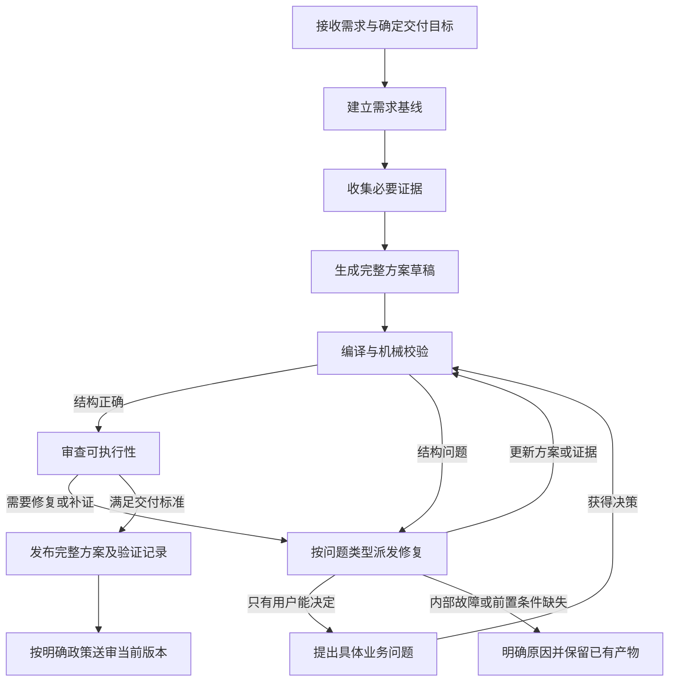

# Orchestrator 规划核心重构分析（2026-10-06）

状态：设计建议，尚未实施。用户已明确第一阶段优先保证“需求拆解到可执行方案”。本文不是已批准的最终规格，也不修改现有任务、审批政策或生产状态。

## 1. 建议与依据

建议保留可复用的运行底座，重新设计规划核心，再分阶段替换。继续补局部条件难以解决跨阶段矛盾；整体推倒则会同时重做传输、恢复和业务规则，增加验证范围。

本次结论基于当前工作树源码、RTC-SDK 真实失败记录及零模型回放。已经证明的是：同一超限计划在入口被接受，局部修订后被拒绝，而被派发的 worker 没有修复超限组的权限。设计层面的其他判断是据此结合源码作出的评估，不应混称为所有历史失败的已证实原因。

| 方案 | 能解决什么 | 主要代价或不足 | 建议 |
| --- | --- | --- | --- |
| 持续定向修补现有流程 | 可以最快修复本次超限与恢复路由 | 权威数据、分组含义和阶段职责仍交织；后续容易再次出现跨阶段冲突 | 仅用于第一阶段止血 |
| 保留底座，重构规划核心 | 统一方案、校验、修复和交付；可用真实样本逐步验收 | 需要明确新旧数据和流程边界 | 推荐 |
| 全部重写 | 可重新选择所有架构 | 同时承担新业务逻辑与新运行底座的风险；旧任务恢复更难 | 当前没有足够依据采用 |

## 2. 根因不只是一条校验漏项

### 2.1 主流程主要按角色组织，缺少按交付目标组织的工序

`cmd/orchestrator/domain/transitions.py:61` 的主路径从 Analyst、Solver、Critic、Freeze 进入另一套 Solver、Analyst、Critic、Gate。`task_type` 在 `cmd/orchestrator/` 中只出现在请求保存和迁移处，没有形成独立的流程路由。

这意味着“生成可执行方案”和“直接完成代码审查”虽然交付目标不同，仍承担相同规划环节。角色接力可以实现工序，但角色换人本身不能证明产物已经前进。应该先定义每步产物和退出条件，再选择需要哪种角色能力。

### 2.2 权威方案与派生表示之间的边界不够一致

`ReviewState` 同时持有 `plan`、`task_items`、`task_groups`、各类审查台账、中书分组文档、门下分组文档以及人工送审快照。多种表示不是天然错误，但必须有唯一写入方向和严格的版本绑定。

当前还存在混合路径：`domain/zhongshu_doc.py:500` 会把 Markdown 第八节反投影为 plan 的验收信号；旧的平铺格式则保留模型直接写入的信号。`contracts/zhongshu_solver.py:105` 又要求文档逐字列出成员验收信号。新旧格式使验收内容的写入规则不同，维护者需要同时理解格式、投影和哈希才能判断哪一份有权修改数据。

建议把权威数据改为结构化方案版本，文档是它的可读呈现。详细论证可以保留为结构化记录中的文本字段，避免丢失设计深度；不能让另一份自由文本文档悄悄改写需求、依赖或验收。

### 2.3 业务分组、批准单元和运行批次混在一起

`GROUP_MAX_ITEMS = 6` 的注释明确把限制解释为审查 capsule 的容量；但超限成为正式方案的结构问题。模型因此被迫把内部执行容量写进业务分解。

同一分组还承担依赖冻结。`zhongshu_review_queue.py:568` 明确指出：合法的条目 DAG 投影到分组后可能产生环。例如任务 A → B → C，展示分组把 A、C 放一起，B 单独一组，就会得到组之间的双向依赖。此时任务本身没有环，但分组冻结策略不能推进。

建议拆为三个概念：工作项描述需要做什么；业务分组用于组织方案和明确责任；运行批次按容量和上下文预算派发。任务依赖表达真实前置条件，展示分组不自动增加一套执行依赖。只有确实需要整体原子交付的业务单元才增加相应约束，并明确其原因。

### 2.4 拒绝规则和修复权限没有形成闭环

入口与预检查使用过滤后的结构校验，局部合并使用完整校验。这已经由真实结果回放证明。更深的缺口是：发现问题之后，没有保证派发者具备消除问题的操作权限。

“保护已批准内容”是合理约束；“无权修改的问题却由当前 worker 负责通过”则是不可达的修复目标。校验结果不能只是一串错误文字，必须携带问题所属范围和可用的恢复方式。

### 2.5 人工门承接了内部故障，审批又早于最终可执行性判断

本次 `NODE_FAIL_STREAK_EXHAUSTED` 要用户介入的是内部容量矛盾。人工重试不能改变权限，人工批准也不能使不合规结构自动合理。

现有生产 `PLAN_REVIEW` 位于中书冻结之后、门下深化之前，且默认强制开启。它是在审查需求版本，不等于审查最终可执行方案。原来批准过的行为必须继续保留；若重构后改为送审完整方案，应作为明确的产品行为变化讨论和批准，不能偷偷关闭现有人审开关。

### 2.6 测试证明了部分路径，而没有证明全局规则一致

当前 `states.py` 有 6381 行，`agent_effects.py` 有 2829 行；其中 `_dispatch_effect` 单个方法有 687 行。行数不是故障原因，但这里确实集中着模式选择、上下文生成、派发和恢复等多项责任。

已有每组修订上限、补证停滞和批准哈希等保护，不是完全没有恢复设计。但这些局部保护不能替代跨阶段一致性和修复可达性测试。此前 1385 项测试及三次小需求脚本没有覆盖本次失败链。

实际任务的局部修订 dispatch payload 约 65 KB，组评审 payload 约 106 KB；这是序列化载荷字节数，不是模型 token 数或完整提示包大小。它提示局部工作仍携带较多全局数据，应继续做上下文依赖审计，不能以缩短上下文为由删掉跨任务接口和关键证据。

## 3. 新机制先明确承诺

第一阶段目标是输出可执行方案。这里的“可执行”不是文档标题齐全，也不是系统已经执行了所有步骤，而是：

- 用户要求有来源，范围与非目标清楚，模型推导出的工作不能冒充用户要求。
- 每项工作有明确输入、操作、产物、前置条件和验收方法。
- 前置依赖可解析且无环，任务之间的输入输出能够衔接。
- 关键设计选择有依据、取舍及必要的兼容或撤回措施。
- 尚未解决的未知项明确标记；影响关键选择或第一步执行的未知项不能隐藏在“已完成”中。
- 未执行的验证写成计划，已执行的验证必须有真实结果记录。

系统应保证运行结果可解释且有界。它不能保证模型面对任意需求一定生成正确方案，但可以保证不会因为内部规则矛盾反复消耗、不会靠用户批准绕过工程缺陷、不会把未完成包装为成功。

终态应区分：`PLAN_READY`（满足方案交付标准）、`NEEDS_USER_DECISION`（有明确业务决策）、`BLOCKED_BY_PREREQUISITE`（权限、资料或环境缺失）、`ENGINE_ERROR`（编排内部故障）、`CANCELLED`。人工是否已批准作为单独记录，不能与方案质量混成一个成功标志。

## 4. 推荐工序

下图是目标体验。迁移模式继续保留现有“需求版本批准后再深化”的检查点；只有用户明确批准新的送审政策后，才能调整为图中的完整方案送审位置。

| 工序 | 输入 | 交付与退出条件 | 主要责任 |
| --- | --- | --- | --- |
| 需求基线 | 用户原文、已确认上下文 | 目标、明确要求、约束、非目标、假设、关键待决项；来源可追踪 | 模型提取，代码检查来源与结构 |
| 必要调查 | 基线、明确调查问题 | 证据及引用，或者资料缺失的明确原因 | Analyst 能力与读取工具 |
| 完整草稿 | 基线、证据、决策 | 总体设计、选择理由、工作项、接口、依赖、验收和风险；无需先造多份分组文档 | Solver 能力 |
| 编译校验 | 草稿、当前版本与政策 | 合法方案版本，或带归属和修复路线的结构问题 | 确定性代码 |
| 可执行性审查 | 同一方案版本、基线、相关证据 | 有依据的阻断问题、建议；检查跨工作项接口及覆盖 | Critic 能力 |
| 定向修复 | 明确问题、允许操作、当前版本 | 可验证的变更及解决说明；补证直接进入证据库 | 对应修复者与统一合并入口 |
| 发布与送审 | 已审查版本、验证记录 | 一份完整可读方案、版本、哈希、待决项和审批记录 | 渲染器、已有发布适配器 |

中书的需求澄清和门下的实施细化都有价值，可以保留为这些工序内部的能力。第一阶段不需要删除角色；需要取消对所有任务强制重复生成、评审和维护多份权威文档的依赖。

建议的最终体验是用户审查完整可执行方案。迁移期间仍保留现有需求版本审批；只在明确批准新的送审政策后调整位置。遇到会改变业务目标、成本或范围的选择可以提前询问，格式问题和内部容量限制不要求用户裁决。

## 5. 权威数据与组件边界

建议建立一个版本化的 `PlanRevision`，包含下列独立记录：

| 记录 | 核心内容 | 写入边界 |
| --- | --- | --- |
| RequirementBaseline | 原始要求及来源、约束、非目标；假设与业务决策分开 | 模型提出，用户澄清产生新基线版本 |
| Evidence | 来源、具体引用、观察内容、适用范围、内容版本 | 读取与调查追加，不能伪造已验证结果 |
| Decision | 选择、备选、理由、引用、影响 | Solver 提案，审查或用户决策确认 |
| WorkItem | 目标、输入、具体步骤、输出、依赖、验收、风险、关联要求 | Solver 创建或在授权范围内修订 |
| Issue | 稳定问题标识、归属、阻断性、依据、解决条件与状态 | 审查提出，验证后关闭 |
| Validation | 校验版本、检查项、结果；已运行验证的真实记录 | 编译器和验证工具 |
| Approval | 明确批准对象、版本、哈希、决策与来源 | 人工决策入口；旧批准不能释放新版本 |

工作项不强制填写尚未调查到的文件路径或编造精确代码行号。已知对象用路径/符号/接口引用；暂未知对象用明确定位步骤，但影响关键设计的未知对象必须先调查。非代码任务使用对应业务输入、产物和验证方式。

提议的新模块位于 `cmd/orchestrator/domain/planning/`，名称为拟议设计，不表示已经创建：

- `model.py`：上述业务记录及版本引用。
- `compiler.py`：结构规范化、来源/覆盖/依赖检查及统一提交前校验。
- `repair.py`：问题类型、可修改范围、允许操作与恢复路线。
- `workflow.py`：按工序推进的纯决策；不负责外部调用。
- `render.py`：从同一方案版本生成阅读文档。
- 运行层另设批次规划职责，按现有 worker 容量分配工作，不改业务分组。

这些职责可以逐步从当前 `states.py`、`agent_effects.py`、`solver_plan.py` 和文档模型中迁出。不要只把大文件平均切小而保留原有责任混合。

保留并验证既有能力：事件序号与日志、任务锁、effect 意图持久化、worker 结果关联、适配器、证据引用检查、批准对象版本绑定。现有持久化与适配器未在本轮重新证明全部无缺陷，保留表示减少重写范围，不等于免检。

## 6. 统一校验与修复协议

校验返回结构化问题，而非仅用字符串前缀让各层自行决定严重性。每个问题应包含：规则标识、对象路径、范围、阻断级别、责任方、允许修复操作、解决条件及适用政策版本。

所有草稿提交、局部合并、发布和批准释放都使用同一套核心不变量。不同工序可以增加明示的成熟度要求，例如草稿允许待决选择，发布不允许关键选择未决；不能在某个合并分支临时把入口的建议升级为隐藏硬约束。

| 问题类型 | 恢复方式 | 是否原样重跑模型 |
| --- | --- | --- |
| 返回格式错误 | 有界格式修复，不消耗实质方案修订预算 | 可以，但提供具体差异 |
| 丢失远程结果 | 先按已有 request/run 身份找回结果，再按幂等策略处理 | 不应立即重新生成方案 |
| 内部批次容量不足 | 调度器重新分批 | 不需要 |
| 任务依赖或跨任务结构错误 | 路由到能修改受影响拓扑的规划修复 | 不能继续派发无权限的局部补丁 |
| 证据缺口 | 按明确问题与来源定向调查，保留已收集证据 | 不应先让 Solver 复述旧内容 |
| 方案内容缺陷 | 修订对应内容并重新审查受影响范围 | 需要语义修复 |
| 业务选择未确定 | 给用户展示选项、影响、推荐及具体问题 | 等待真实决策 |
| 内部规则自相矛盾 | 工程错误，保留版本与诊断，不假称需要业务批准 | 相同输入与权限下禁止重复 |

派发前验证“这组操作是否有机会解决这类问题”。这是一种针对已知机械约束的检查，不是声称可以自动证明所有语义缺陷可修复。

修改业务需求基线必须获得相应用户决策，不能为消除编译错误扩大权限到任意改需求。拓扑修复可以改工作项、任务依赖及组织方式，但必须守住需求来源和既有业务约束。

新补丁按基线版本及对象哈希应用；合并后统一校验再提交。真实受影响的内容、接口及依赖审查失效，其他审查按内容与输入证据绑定复用。全局方案摘要可以变化而局部工作项不变，不能因此让所有局部批准失效；已批准的全局发布版本仍必须重新绑定新的整份哈希。

## 7. 收敛、成本与失败输出

保留已有“旧问题关闭才算进展”和“新证据必须有不同来源/引用”的思想，进一步将状态放在统一问题台账中。

- Solver 声称修好，只进入待验证状态；编译器或相应 reviewer 验证后才能关闭。
- 改写句子、改变文档哈希或换问题编号，不能单独计为进展。同一问题的新表述要与原问题建立关联。
- 新发现的问题必须有依据及对执行的具体影响。表达偏好进入建议，不能无限追加为阻断。
- 格式、补证、语义修订、外部调用有各自预算，同时设置整次任务的调用与时间上限；具体预算作为运行配置，不能冒充用户业务要求。
- 重试签名包含规则、对象、方案输入、可修改范围和动作。同一确定性问题在这些因素不变时，不重复同一动作。
- 每次 dispatch 只携带阶段输入、相关要求、受影响工作项、跨项接口与所需证据。共同资产使用版本引用及缓存，不能因切片把必要的全局约束删掉。

预算耗尽也必须交付已有方案版本、未解决问题及下一步所需条件，但不能标为 `PLAN_READY`。不能以降低验收要求来制造跑通率。

## 8. 第一阶段怎样验收

“任务跑完”与“方案可执行”分开验收。机械检查可以保证引用、版本、依赖和结构；语义是否充分仍需要样本评审。真实模型是最后的验收层，不能代替可重复的机制测试。

| 样本/检查 | 必须验证的结果 |
| --- | --- |
| 本次 RTC 真实结果回放 | 相同违规不能先接受后在无关局部补丁中拒绝；容量问题能由调度处理或在入口正确路由 |
| 有效的 A → B → C，展示组为 A/C 与 B | 展示分组不制造新的执行环或冻结死锁 |
| 用户没有数值目标的需求 | 不添加无来源的数量门槛；推导任务与用户要求区分 |
| 缺少重要现状信息 | 先调查或提出明确决策；不得编造路径、兼容结论、测试通过 |
| 局部修订、补证、跨任务接口修订 | 复用未受影响结果，重新检查真正受影响内容；计数符合实际操作 |
| 重启、重复结果、旧版本批准 | 不丢台账，不重复已完成 worker，不用旧批准放行新版本 |
| 真正无进展与内部不可修复问题 | 在配置预算内终止，区分业务待决与工程故障 |
| 完整规划闭环 | 第一项工作能执行；所有工作有产物与验收；步骤串接可以达到原始目标 |

零模型样本应覆盖实际状态/提交入口，而不只比较单个 helper。增加性质测试：同一合法版本经不同路径提交，核心规则结论一致；无关局部补丁不能改变未触碰组的合法性；新运行批次不能改变业务方案。

之后做少量有预算的真实模型规划，逐条检查需求来源、设计理由、步骤可执行性和未知项。连续通过用于积累证据，不声明“一次全绿就永远稳定”。记录成功率时把机械成功、语义合格、需要正常用户决策和工程失败分别统计。

## 9. 分阶段迁移

1. **校验与恢复闭环。** 在现有 FSM 中统一结构问题政策及错误归属，补齐有权限的恢复路线；用 RTC 保存结果作为回归入口。在批次与业务分组尚未拆开之前，暂保留现有 6 项限制，但在初始接受时就检查，超限路由到能重新分组的规划修复，不能继续锁组后要求局部补丁消除它。不改人审、不迁移旧任务。
2. **引入权威方案版本。** 新增结构化方案及唯一提交入口；旧台账和文档通过适配生成，切断新流程对 Markdown 反投影的依赖。明确新旧 schema/政策版本。
3. **引入按产物推进的规划流程。** 只对新任务启用 `planning` 工作流，先串行闭环再接并发；保留当前人工需求审批。完成一份完整方案的机械与语义验收。
4. **明确新送审政策。** 用户认可后调整为审查完整可执行方案，或保留需求/方案两个明确检查点。批准对象始终绑定确切版本。
5. **迁移成熟后清理旧路径。** 不自动把停在人工门的老任务转换到新规则；运行中的旧任务使用原流程版本，新任务可切回旧配置。涉及旧任务恢复另行显式决定。

每一步都应有独立验收和配置回退。不要同时修改角色提示词、数据模型、审批政策、并发和传输，然后只用一次真实任务判断成败。

## 10. RTC 示例如何检验新方案

原 RTC 请求实际希望得到提交安全判断；它不是仅要一个审查计划。第一阶段规划能力可以输出可执行的审查方案，用来检查规划质量，但必须明确“审查方案已生成，代码审查尚未完成”。未来代码审查工作流还需要执行调查与验证，最终输出实际风险及提交建议。

该方案至少串接以下真实工作：固定代码变更范围和 diff 版本；逐项审查具体 C# 变更及受影响调用；评估逻辑、兼容、异常、资源与线程问题；列出适用验证及环境前置条件；按证据形成风险清单与提交判断。需要与 Unity 环境结合的验证明确步骤和限制，不能只写“充分测试”。

业务上可以把相关审查维度放在同一章节；调度器按容量拆审查批次。不会再因为这个章节包含 8 个工作项，就要求用户裁决或让另一个章节的修订者去拆它。

## 11. 本轮产出边界

本文给出源码证据、重构选择、目标工序、数据职责、恢复协议、验收和迁移顺序。生产代码尚未更改，新的流程尚未运行，现有审批政策仍有效。

后续详细实施计划应首先覆盖第 1 阶段，待设计确定后给出逐文件改动与回归步骤；不要先生成整套重写任务再倒推设计。

相关审计：`docs/multi/runtime/rtc-sdk-orchestrator-failure-audit-20261006.md`。

真实回放：`runs/maintenance/20261006-rtc-review-audit/replay.py` 与 `replay-report.json`。
