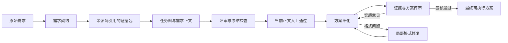

# Orchestrator 工序审查与稳定化记录

本轮将已复现的工序缺陷修复到源码，并用固定小需求验证从需求提取到最终方案的闭环。真实模型的方案质量尚未验证，脚本成功不能作为生产成功率。

## 问题定位

分工方向可以保留。阻碍稳定运行的主要问题是：工序边界在部分分支依赖含混的数据形状，进展计数没有始终对应实际处理的问题，测试使用的简化回复遗漏了正式证据包路径。

| 层面 | 已复现问题 | 本轮处理 |
| --- | --- | --- |
| 代码与测试覆盖 | 初次证据包保存在 `review.plan`。Solver 回复缺少 `mode` 时被当作修订，第一次正式任务图被拒为 `SOLVER_GROUP_DOC_FROZEN`。旧全链路脚本的初次 Analyst 回复没有真实证据包，未发现该断点。 | 带证据包标记且没有任务图、没有 Critic 问题时仍进入正式化；保留真实任务图及批次的修订约束。完整验收改用证据包。 |
| 代码记账 | 补证复审被记作 Solver 修订失败；同一个批次可在后续复审反复增加 `stuck_rounds`。 | 有效评审按组消费实际 Solver 批次；失败回复不消费，部分成功保留未评审组机会；旧快照补证不按全问题计数。 |
| 机制 | 移除错误修订计数后，反复补证缺少独立、持久化的组预算。 | 单独记录已完成补证轮次与 source/quote 集合；没有新证据连续达到停滞限额，或达到总预算，就停泊对应组。新 evidence ID 和改写结论不代表新证据。 |
| 机制与调度 | 一组停滞触发全任务人闸，其他组的待审或修订被截断。 | 停泊明确归属的组；其他组继续要求的修订、补证或评审。停泊组退出相应调度。生产仍须整份需求批准后才进入门下省。 |
| 进展判据 | Menxia 按问题数量判断进展，旧问题解决但新问题等量出现时被误判；正常 Solver/Analyst 跳转会清除停滞连续计数。 | 从验证过的文档提取阻断建议与待确认反驳 ID，保存上次评审基线；正常工序不覆盖基线。关闭旧问题视为进展，真正重复问题仍有界，总修订预算保留。 |
| 需求边界 | 用户只要求审查优化空间，提取结果却能添加“至少 3 个方向”等验收。 | 数量限制必须有对应 `source_quote` 依据；提示词要求假设、审查范围和未知项分别说明。保留人工需求审查，因为机械检查无法识别全部语义扩张。 |

历史任务 `task-20261006-3a0200` 的序列 6–13 显示：首组已经收敛，次组重复 Critic→Analyst→Critic 补证，没有新的 Solver 修订，旧 finding 的停滞计数却从 0 增至 3。本轮据此建立了回归。审查时读取的 44 份顶层历史快照中，人闸 27、BLOCKED 5、FAILED 3、其余活动状态 9；其中部分是正常需求审批。这些跨版本快照不是完成率统计。

## 固定验收工序

输入：审查本仓库 orchestrator 的补证与修订路由，交付现状、缺陷证据、最小修复步骤和验收方法；保持现有服务可用，不引入无依据数量要求。



连续 3 次独立运行，均到 `DONE`，每次 16 个状态序列。每次验证了：

- 初次正式证据包进入正式化，需求源文引用经过 transport guard。
- 整份需求先进入 `PLAN_REVIEW`；通过前没有 Menxia 派发。
- 批准门槛处重新构建应用并从持久化状态继续；批准使用明确标记的脚本测试回复。
- 缺少规定章节的初稿被实际文档合同拒绝，格式修复不占实质修订预算。
- Critic 提出回退与预算用尽处理意见，Solver 修订至 v3，意见吸收，Analyst/Critic 签核闭合。
- 最终产物包含改动位置、执行命令、通过条件与回退说明。

模型调用为 0，外部通知关闭。门下省正文与角色回复是固定测试数据；本轮验证真实应用、调度、合同、批准绑定、持久化恢复和文档签核，不验证模型能否自行提出正确方案。

验收入口：`cmd/smoke_orchestrator_plan_pipeline.py`。独立复跑命令：

```powershell
rtk proxy python -X utf8 cmd/smoke_orchestrator_plan_pipeline.py --repeat 3
```

每次使用新的输出目录。若指定 `--output`，不要复用已有任务快照的目录。

本轮产物：

- `runs/maintenance/20261006-workflow-stabilization/acceptance-passed/summary.json`
- `runs/maintenance/20261006-workflow-stabilization/acceptance-passed/run-1/requirements.md`
- `runs/maintenance/20261006-workflow-stabilization/acceptance-passed/run-1/final-plan.md`
- `runs/maintenance/20261006-workflow-stabilization/acceptance-passed/run-1/report.json`，以及 run-2/run-3 对应记录。

## 验证与使用边界

所有自动测试通过 `cmd/run_tests.py` 禁用外部通知。最终全量 **1385/1385 通过，耗时 60.774 秒**，结果记录在 `runs/maintenance/20261006-workflow-stabilization/full-tests-verified.log`；`rtk git diff --check` 通过。新增 31 项回归，覆盖 `cmd/test_orchestrator_stabilization.py` 中的边界与完整工序验收，并与现有入口、收敛、冻结、人审、证据与 Menxia 文档测试一起验证。

源码已更新。没有停止当前 Nexus 服务，没有改已有任务快照，没有修改 Codex 全局模型路由配置。已有 Python 运行进程不会因此自动替换已加载的代码；后续新启动的 orchestrator 才使用当前源码。当前工作区原有其他修改未回退、未合并提交。

数量检查覆盖显式数量与上/下界，不能证明语义完整性。补证进展判据衡量新来源/引用，不能证明引用足以支持结论；总预算保证此类争议不会无限循环。现有 `FREEZE_WITH_FOLLOWUPS` 对残余 P1 的接受策略本轮保留，最终质量需看跟进项内容。真实模型验收应继续使用同一个小需求，分别检查工序闭环和最终正文，不用扩大重试预算替代问题定位。

回退时只撤销本轮增量，保留原有工作区修改和历史任务。改动前的 8 个主要源码副本保存在 `runs/maintenance/20261006-workflow-stabilization/before-*.py`，用于比对本轮补丁，不应覆盖整个文件来抹掉并存修改。
