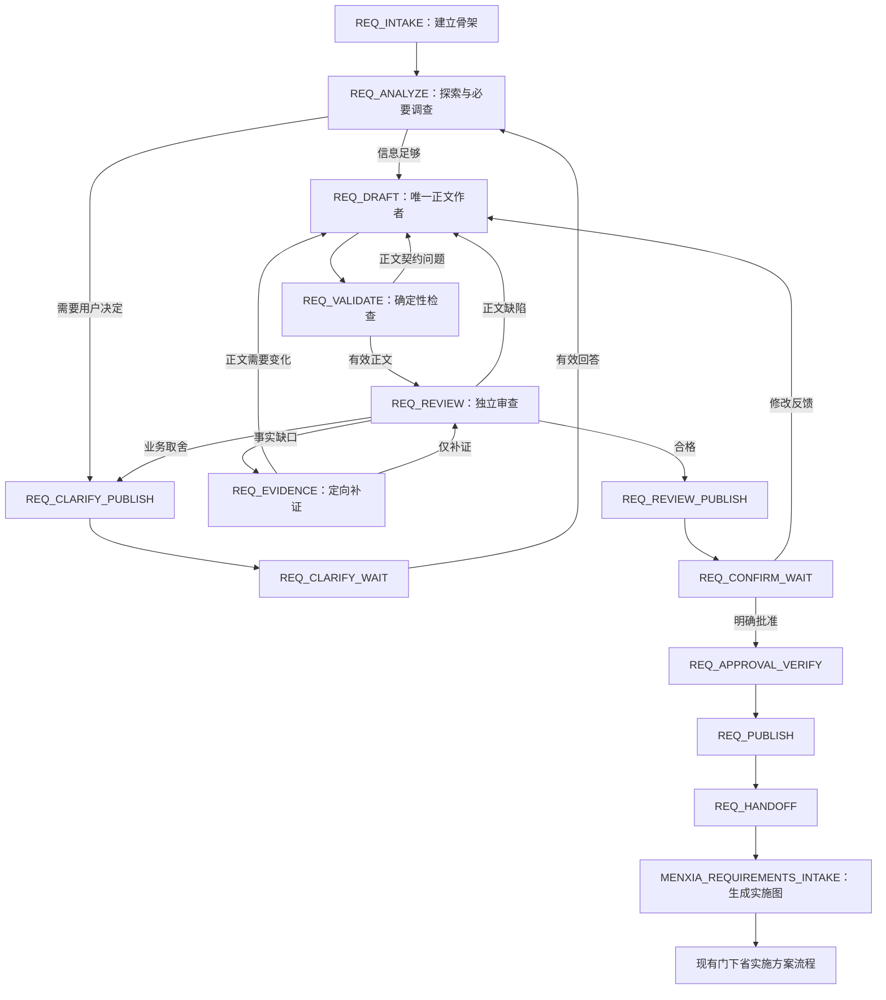

# 中书省稳定需求产出工作流重构 Implementation Plan

> **For agentic workers:** REQUIRED SUB-SKILL: Use superpowers:subagent-driven-development (recommended) or superpowers:executing-plans to implement this plan task-by-task. Steps use checkbox (`- [ ]`) syntax for tracking.
> 本方案交付到实施准备阶段。任务勾选表示实施记录，本文中的验证结果均为预期结果，不表示代码已经实现或测试已经运行。执行技能不可用时，工程师可以按本文逐任务执行。
> 需求来源：[中书省需求草案生成与飞书批量澄清需求](../specs/2026-10-07-zhongshu-requirements-workflow-requirements.md)。
> 编写基线：2026-10-07，Git HEAD `78f2678`，并核对当前工作区。实施前须重新检查入口及文件状态。

**Goal:** 将中书省重构为以完整需求文档为核心、可通过用户交流演进、具有独立质量审查和有界修复能力的工作流；用户确认的同一份需求正文直接成为门下省的实施设计输入。

**Architecture:** 新建 `requirements-v1` 工作流与独立需求领域模型，替换新任务的中书省任务图、组级收敛和冻结机制。Analyst 维护分析与事实，Solver 是正文唯一作者，Critic 对正文及其来源独立审查；编排器维护用户决定、问题路由、版本、预算、发布及恢复。复用现有 journal-first 仓库、事件收件箱、outbox、AgentWorkerRunner、Multica transport、锁和内容寻址文件存储；旧任务使用原有状态图恢复。

**Tech Stack:** Python 标准库、dataclasses、unittest、SQLite；现有 Multica transport 和飞书文档 CLI；飞书卡片 JSON 2.0，官方 `lark-oapi==1.7.3` 的底层 WebSocket 与事件 dispatcher。SDK 仅用于独立卡片接收进程，需求领域与自动测试不依赖其网络或凭据。

> **2026-10-07 实施进度：** 新领域、状态机、协议、交互持久化、批准与门下输入、CLI 和本地恢复已接入，脚本机制与旧流程回归已通过。实际测试、实现位置与未完成项见 [实施验证记录](../../multi/runtime/requirements-workflow-validation-20261007.md)。Task 12 的六份真实模型样本被自动审批挡住，待具体输入/目标 worker 授权；飞书往返与业务评审待完成。用户已明确指定沿用现有同步消息群，不要求隔离群。因此 Task 13 默认切换未执行。本文以下命令与提交点保留为计划，不表示已发生 Git 提交或通过真实发布验收。

---

## 0. 设计选择与实施边界

### 0.1 已确定的路线

| 路线 | 效果与代价 | 本方案决定 |
|---|---|---|
| 在旧任务图上增加骨架、澄清和更多恢复规则 | 接入较小，但正文仍受图、分组、冻结和既有权限制约 | 不采用 |
| 新需求领域、新状态图，复用成熟运行底座 | 能建立清晰不变量；需完成版本化接入和门下省输入适配 | 采用 |
| 同时重写 transport、持久化、门下省及 Web 控制台 | 范围大，难以区分需求产出改进与基础设施回归 | 不采用 |

新需求工作流没有 `ZHONGSHU_FREEZE_CHECK`、组级投票、按 worker 容量拆正文、实施任务 DAG 前置校验。旧机制只用于旧任务恢复与显式回退。门下省在需求确认后建立实施图；图是其实施产物，不再反向决定中书省正文结构。

### 0.2 当前代码事实

| 已核实的位置 | 当前行为 | 重构处理 |
|---|---|---|
| `cmd/orchestrator/app.py:938` / `main()` | 入口没有 `--workflow`；新任务默认 `legacy-v1` plan schema | 增加工作流选择；新中书省任务在发布阶段切换默认值 |
| `domain/states.py:6366`、`domain/transitions.py` | 注册旧中书省和门下省状态；状态类直接引用旧 transition registry | 新工作流使用独立 registry；旧类不承担需求状态 |
| `contracts/__init__.py` | 未注册 `PLANNING_*` 契约 | 不将未接入草稿视为可运行基线 |
| `domain/planning/model.py`、`compiler.py` | 已有 canonical 实施任务图与派生文档 | 留给门下省和旧流程；不作为新需求正文模型 |
| 未跟踪的 `domain/planning/workflow.py` 等 | 存在 `planning-v1` 草稿，但入口、DTO、registry 没有配套接入 | 依本方案替代其需求路径；实施记录明确退役的草稿文件 |
| `domain/planning/render.py` | 以组成员 JSON 拼成九章节文档 | 新正文由 Solver 编写，renderer 只做确定性排版 |
| `runtime/engine.py:129` | DirectNotificationEmitter 在 transition commit 前可能执行通知 | 新工作流通知必须通过提交后的 outbox；旧流程保持兼容 |
| `app.py:_poll_human_gate_reply()` | 澄清回复被拼为字符串；人审对旧 packet 校验 | 新回答按问题绑定；新审批按正文与审查输入绑定 |
| `adapters.py:FeishuHttpAdapter` | 发文本和轮询聊天；没有卡片提交接收进程 | 独立卡片 adapter、持久收件箱与长连接 gateway |
| `feishu_review_document.py` | 已有创建意图、恢复、读回检查和审批前核验 | 复用其发布器，增加新工作流的强语义读回规则 |
| `domain/context.py:seed_menxia_groups()`、`states.py:4445` | 门下省主要依赖旧 task graph、组文档和 plan_review packet | 增加已批准需求输入，门下省负责初始化实施图 |

工作区中的 `worker01.json`、`worker02.json`、`worker03.json` 与无关变更不进入本方案。未跟踪的规划草稿不得在实施过程中被不加说明地覆盖；其处理规则见 Task 13。

### 0.3 本次必须完成的闭环

1. 从明确或模糊请求建立讨论；必要时多轮批量澄清。
2. 产出一份连贯正文，审查、定向修复、用户反馈、重新确认。
3. 正文、用户决定和审查依据版本可追溯；进程重启不重新调查或丢答案。
4. 飞书表单提交进入持久事件；发布失败、重复提交、旧版本和未授权操作可解释。
5. 门下省能实际接收批准正文并开始实施设计，不以“写了 handoff 文件”冒充已经交接。
6. 有代表性产物评审与运行指标，能够区分机制正确、内容品质和效率收益。

本次不重写门下省内部 Analyst/Critic 审查方法，不修改业务项目代码，不变更模型选择及 Codex 全局路由，不自动迁移运行中任务，不以真实模型代替机制测试。

## 1. 所有任务共同遵守的不变量

1. **正文唯一作者：** 只有 Solver 能生成或修改 `DraftSection.markdown`。模板提供空结构；Analyst 提交分析和事实；Critic 提交 findings。renderer 不补写业务内容。
2. **用户决定独立：** 用户决定追加到不可变记录；分析更新不得覆盖决定。改变决定必须引用原决定并有新的用户输入。
3. **需求允许演进：** 原始请求不可变，当前需求集合可随澄清、补充和反馈更新；不锁死首次提取的 requirements 数组。
4. **同一审查对象：** Critic、用户和门下省使用相同版本的正文；审查绑定正文、当前共识和必要事实指纹。
5. **批准不等于回答：** 表单答案只解决对应问题。只有当前确认卡片上的明确批准或等价的带版本 CLI 动作能批准正文。
6. **有问题的产物不冒充合格：** 预算耗尽、卡片未响应、接口错误和用户批准都不能消除尚未解决的实质缺陷。
7. **副作用在提交之后：** 发卡片、发文档、接收结果落地、交接和通知均由持久 effect 执行；状态处理函数不得直接做网络调用。
8. **新旧隔离：** `workflow` 在创建时持久化；恢复不从默认值、环境并发开关或 `--fast-track` 切换工作流。
9. **有限自动工作：** 同一机器工作周期内的自动派发和修复有上限；用户等待不计为失败。重复的相同答案不能刷新预算。
10. **权限可修复：** 如果问题属于受保护决定，只能提出变更请求；不能给 Solver 一个无权实现的修改目标。
11. **信息不靠正文隐藏携带：** IDs、hash、审查账本、卡片状态及 worker 状态进入 sidecar/manifest，不要求用户从正文拼协议。
12. **测试通知隔离：** 统一通过 `rtk proxy python -X utf8 cmd/run_tests.py`；新增飞书写接口和 gateway 在 `NEXUS_TEST_NO_EXTERNAL_NOTIFICATIONS=1` 时也必须拒绝真实 I/O。
13. 当前 Nexus 的正常端口 `8766` 保持可用。需要 HTTP 验证时使用 `18766`。卡片 gateway 使用出站 WebSocket，不新增对公网的 HTTP 回调端口。
14. 不编辑 `C:/Users/Administrator/.codex/config.toml` 或 `nexus-model-catalog.json`；不读取或打印密钥。Git 提交按实施时的用户授权执行。

## 2. 新领域模型与单一正文

### 2.1 聚合与记录

在 `domain/requirements/` 定义 frozen dataclasses。集合用 tuple；可变 JSON 仅出现在 transport/DTO 边界，解码时复制和校验。字符串正文保持 UTF-8、LF、无 BOM，不擅自删除用户文本或代码块中的空格。

| 类型 | 字段与用途 |
|---|---|
| `SourceRecord` | `source_id, kind, text, author_id, external_id, created_at, supersedes_ids`；kind 为 request/answer/feedback/fact；原文不改写 |
| `RequirementClaim` | `requirement_id, topic_key, statement, kind, origin, source_ids, decision_ids, status`；kind 为 goal/behavior/constraint/non_goal；origin 为 explicit/choice/derived/proposal；status 为 active/proposed/superseded/rejected |
| `DecisionRecord` | `decision_id, topic_key, conclusion, source_id, supersedes_ids, requirement_ids`；由有效人类提交建立，不能由模型伪造 |
| `FactRecord` | `fact_id, observation, source, quote, source_fingerprint, status, requirement_ids`；status 为 observed/unavailable；沿用文件逐字引文校验 |
| `AssumptionRecord` | `assumption_id, statement, source_ids, blocking, disposition`；disposition 为 proposed/accepted/deferred/rejected |
| `ConsensusRevision` | `version, parent_digest, claims, active_decision_ids, facts, assumptions, pending_source_ids, digest`；当前解释可变化，来源与决定历史不删除；尚未解释的人类补充也使输入指纹失效 |
| `Question` | `question_id, topic_key, question, reason, impact, answer_kind, options, recommendation, default_assumption_id, blocking, depends_on_question_ids, related_requirement_ids, related_issue_ids, revision` |
| `QuestionOption` | `option_id, label, consequence`；选项不是需求来源，提交的选择才是来源 |
| `ClarificationRound` | `round_id, consensus_digest, question_ids, page_ids, status, return_to, actor_ids`；status 为 preparing/open/partial/answered/superseded/cancelled |
| `AnswerRecord` | `answer_id, question_id, question_revision, round_id, option_ids, free_text, disposition, source_id, event_id`；disposition 为 answered/accept_default/defer |
| `DraftSection` | `section_id, kind, title, markdown, requirement_ids, decision_ids, fact_ids, related_section_ids`；kind 为八个核心语义或 topic |
| `DraftRevision` | `version, title, sections, consensus_digest, document_digest, change_summary, parent_digest`；正文由 sections 确定性渲染 |
| `ReviewIssue` | `issue_id, rule, section_ids, requirement_ids, claim, impact, severity, owner, acceptance, basis_source_ids, status, previous_issue_id`；severity 为 blocking/advisory；owner 为 solver/analyst/user/engine/menxia |
| `ReviewStamp` | `input_digest, document_digest, consensus_digest, facts_digest, issue_ids, affected_section_ids, coverage, passed, policy_version` |
| `ApprovalRecord` | `approval_id, document_digest, consensus_digest, review_input_digest, actor_id, external_event_id, approved_at, cloud_revision_ref` |
| `PendingApproval` | `request_id, gate_id, document_digest, review_input_digest, actor_id, event_id, received_at, close_barrier_id`；核验之前不得转换成 ApprovalRecord |
| `DispatchCharge` | `logical_dispatch_id, kind, attempts, format_repairs, external_retries`；持久去重与逐派发预算 |
| `BudgetLedger` | `policy_version, work_epoch, epoch_input_digest, calls, total_calls, semantic_repairs, evidence_repairs, dispatch_charges, publication_retries, last_progress_digest, stalled_count`；publication_retries 是 effect_id/count 的 tuple |
| `WorkItem` | `work_id, kind, issue_ids, question_ids, depends_on_work_ids, status`；kind 为 clarify/evidence/draft/review，status 为 pending/running/done/superseded |
| `RequirementsFailure` | `code, stage, component, message, artifact_ref, prerequisite_fingerprint, unblock_condition`；不含 secret |
| `RequirementsRecovery` | `failed_state, retry_return_to, logical_dispatch_id, failed_reply_ref, failure, repair_fingerprint`；失败及重试的持久返回点 |
| `RequirementsDispatch` | `logical_dispatch_id, request_id, state, base_document_digest, base_consensus_digest, review_input_digest, status`；status 为 active/superseded/completed |
| `RequirementsState` | `sources, decisions, consensus, questions, rounds, answers, draft, issues, review_stamp, pending_approval, approval, budget, work_queue, active_dispatch, recovery, outcome, reason, handoff_ref` |

IDs 使用任务内单调序列，编排器生成 `src-000001`、`req-000001`、`q-000001`、`finding-000001`。模型新条目用本次结果内的 local key，编排器分配稳定 ID 并重写引用；已有 ID 必须沿用。`topic_key` 是分析建议的业务身份，不能仅凭文字相近自动合并两个用户决定。

`WorkflowContext` 新增 `requirements: RequirementsState | None`；`RequestState` 新增 `workflow: str = "legacy-v1"` 和 `decision_actor_ids: tuple[str, ...] = ()`。`ContextUpdate` 新增 `requirements: RequirementsState | None`，表示整个 frozen 聚合替换，不新增任意 dict patch 入口。

字段类型统一：ID/hash/正文为 str，version/revision/counter 为 int，blocking/passed 为 bool，时间为 UTC ISO-8601 str，关联 ID 集合为 tuple[str, ...]；records 为其类型的 tuple。consensus/draft/review_stamp/pending_approval/approval/active_dispatch/recovery 在尚未产生时为 None，budget 必须存在。coverage 使用 `ReviewCoverage(axis, section_ids, conclusion, basis_digest)` 的 tuple；round.page_ids 对应 gateway 的持久 descriptor，不存 SDK 对象。outcome 固定为 IN_PROGRESS/WAITING_CLARIFICATION/WAITING_CONFIRMATION/PREREQUISITE_BLOCKED/ENGINE_ERROR/CANCELLED/REQUIREMENTS_READY。枚举用 str Enum 并严格解码，缺字段与未知值不得静默回退。

requirements/model.py 不 import context/states/runtime。ApprovedRequirementsInput 定义在 requirements/handoff.py，只依赖 model；ReviewState 的 DTO 在边界导入它，防止新增 context→handoff→context 环。

### 2.2 骨架及正文生成

固定八个语义锚点：`background, goals, scope, constraints, behavior, rules, acceptance, non_goals`。锚点用于验证和定位；正文标题由 Solver 按主题编写，不要求固定编号、固定中文标题或 `group_id`。

```python
def render_markdown(draft: DraftRevision) -> str:
    blocks = ["# " + draft.title]
    blocks.extend("## " + section.title + "\n\n" + section.markdown
                  for section in draft.sections)
    return "\n\n".join(blocks) + "\n"
```

以上函数不得读取 plan/items/groups，不得调用模型、补写非目标、拼入日志或附加另一个需求摘要。`document_digest` 是返回文本 UTF-8 字节的 SHA-256。`version`、来源索引和审查记录写在 manifest，不改变被批准的正文。

初始模板只把原请求放入背景的“初始请求”引用，其他章节为空并在 sidecar 登记缺口；它是 skeleton，不可发布为合格草案。Solver 第一次交付后必须填满适用的核心语义；确实不适用的内容写明原因，不伪造状态机、指标或并发要求。专题可以扩展，文档不因专题数量超过 worker 容量被拒绝。

送审目录为 `runs/<task_id>/requirements/drafts/vNNN-<document_digest>-<review_input_digest>/`，含正文、共识、来源映射、review 和 manifest；它没有 approval.json。当前正文不变但事实/审查输入变动时，保存新的送审目录，不能覆盖旧 review。

批准后的最终目录：

```text
runs/<task_id>/requirements/approved/vNNN-<document_digest>-<approval_id>/
  requirements.md       # Solver 正文的确定性渲染；所有角色使用相同字节
  consensus.json        # 有效需求、决定、事实、假设及其来源
  traceability.json     # claim/decision/fact 到 section 的引用
  review.json           # 输入指纹、coverage、findings、有效审查结论
  approval.json         # 确认后才写入；无批准则不生成伪批准文件
  manifest.json         # 各文件 SHA-256、版本、policy、送审回执与批准依据
```

使用已有内容寻址 store 归档原始输入和回复。上面可读目录由独立 effect 原子 materialize，manifest 最后写入；同路径不同字节必须拒绝。送审与最终目录中的 requirements.md 字节一致；不通过向旧 manifest 追加批准/交接状态破坏不可变性。运行中的发送、交接状态保存在 WorkflowContext 和 journal；最终目录只在 ApprovalRecord 已建立后创建一次。

## 3. 状态图、调度和停止规则

### 3.1 主流程



新工作流的异常状态为 `REQ_BLOCKED`、`REQ_ENGINE_ERROR`、`REQ_RETRY_WAIT`、`REQ_CANCELLED`。`REQ_BLOCKED` 和 `REQ_ENGINE_ERROR` 保留聚合，停止自动派发，明确解除条件；不显示“请批准继续”。成功的中书省结果在交接接受时登记 `REQUIREMENTS_READY`，后续门下省完成与否使用独立阶段结果。

requirements-v1 的 terminal_states 固定为 DONE/REQ_CANCELLED/FAILED；wait_states 为 REQ_CLARIFY_WAIT/REQ_CONFIRM_WAIT/REQ_BLOCKED/REQ_ENGINE_ERROR，以及只供门下省使用的 HUMAN_GATE/BLOCKED/PERSISTENCE_DEGRADED；retry_states 为 REQ_RETRY_WAIT/RETRY_WAIT。共享系统状态只允许返回门下省阶段，不能在中书省内部故障时走 HUMAN_GATE。REQ_CANCELLED 注册独立终态对象；不复用 name=CANCELLED 的对象冒名注册。

### 3.2 闭合转移表

| 状态 | 动作 | 目标/处理 |
|---|---|---|
| REQ_INTAKE | START | 建 skeleton → REQ_ANALYZE |
| REQ_ANALYZE | ANALYSIS_READY | merge 分析；无阻断问题 → REQ_DRAFT，有问题 → REQ_CLARIFY_PUBLISH |
| REQ_DRAFT | DRAFT_READY | 新正文 → REQ_VALIDATE |
| REQ_DRAFT | NEEDS_CLARIFICATION / NEEDS_EVIDENCE / NEEDS_ANALYSIS | 问题加入 ledger，分别 → 澄清发布 / REQ_EVIDENCE / REQ_ANALYZE |
| REQ_VALIDATE | VALID / REPAIR_CONTENT / ENGINE_FAILURE | → REQ_REVIEW / REQ_DRAFT / REQ_ENGINE_ERROR |
| REQ_REVIEW | REVIEW_READY | 持久所有问题，按 §3.3 路由；无 blockers → REQ_REVIEW_PUBLISH |
| REQ_EVIDENCE | EVIDENCE_READY | merge 指定事实；声明需修改正文 → REQ_DRAFT，否则 → REQ_REVIEW |
| REQ_CLARIFY_PUBLISH | CARD_DELIVERED | → REQ_CLARIFY_WAIT；已提交答案始终保留 |
| REQ_CLARIFY_WAIT | ANSWERS_SUBMITTED | 保存有效答案；未满足问题集留原状态；完整后按 round.return_to 返回 |
| REQ_REVIEW_PUBLISH | REVIEW_DOCUMENT_DELIVERED | 读回一致后 → REQ_CONFIRM_WAIT |
| REQ_CONFIRM_WAIT | REQUIREMENTS_FEEDBACK | 添加来源、撤销当前候选审批 → REQ_DRAFT |
| 其他仍开放的REQ讨论状态（包括REQ_APPROVAL_VERIFY） | REQUIREMENTS_FEEDBACK | 添加来源与pending_source_ids，旧review/批准请求失效；内部FEEDBACK_TO_DRAFT → REQ_DRAFT；先登记旧active dispatch为superseded，等其完成再发新调用 |
| REQ_CONFIRM_WAIT | REQUIREMENTS_APPROVED | 保留“批准请求”但尚不生成 ApprovalRecord → REQ_APPROVAL_VERIFY |
| REQ_APPROVAL_VERIFY | APPROVAL_VERIFIED | 同版本、当前 review、无待处理反馈、云端未变化 → REQ_PUBLISH |
| REQ_PUBLISH | REQUIREMENTS_PUBLISHED | 本地所有产物完成 → REQ_HANDOFF |
| REQ_HANDOFF | HANDOFF_PERSISTED | 原文及批准记录已写入门下省输入 → MENXIA_REQUIREMENTS_INTAKE |
| MENXIA_REQUIREMENTS_INTAKE | IMPLEMENTATION_SCOPE_READY | 接受来源，建立实施图 → MENXIA_GROUP_SOLVER |
| 任一非终态 | CANCEL | REQ_CANCELLED；使卡片失效，停止新增派发 |
| 任一自动阶段 | PREREQUISITE_MISSING | REQ_BLOCKED；保存具体解除条件 |
| 任一自动阶段 | ENGINE_FAILURE | REQ_ENGINE_ERROR；不转换成审批 |
| 任一自动阶段 | RETRYABLE_FAILURE | 有预算及有效修复材料 → REQ_RETRY_WAIT，否则 REQ_ENGINE_ERROR |
| REQ_RETRY_WAIT | RETRY_READY | 仅返回持久化的 retry_return_to，不接受任意 target |
| REQ_BLOCKED / REQ_ENGINE_ERROR | RECOVERY_INPUT | 新前提或修复指纹可验证后回原失败工序；预算不因重启清零 |

上表描述领域事件与处理结果，不能直接把一个 source/action 注册到多个 target。状态函数校验结果后采用以下内部 transition action；它们由编排器生成，模型协议及用户入口不得直接提交：

| 已验证的事件 | 内部 action → target |
|---|---|
| REQ_ANALYZE / ANALYSIS_READY | ANALYSIS_ACCEPTED → REQ_DRAFT；ANALYSIS_NEEDS_USER → REQ_CLARIFY_PUBLISH |
| REQ_REVIEW / REVIEW_READY | REVIEW_PASSED → REQ_REVIEW_PUBLISH；REVIEW_NEEDS_DRAFT → REQ_DRAFT；REVIEW_NEEDS_EVIDENCE → REQ_EVIDENCE；REVIEW_NEEDS_USER → REQ_CLARIFY_PUBLISH |
| REQ_EVIDENCE / EVIDENCE_READY | EVIDENCE_TO_DRAFT → REQ_DRAFT；EVIDENCE_TO_REVIEW → REQ_REVIEW |
| REQ_CLARIFY_WAIT / ANSWERS_SUBMITTED | ANSWERS_TO_ANALYZE → REQ_ANALYZE；ANSWERS_TO_DRAFT → REQ_DRAFT；部分回答只更新聚合，无 transition |
| REQ_RETRY_WAIT / RETRY_READY；REQ_BLOCKED、REQ_ENGINE_ERROR / RECOVERY_INPUT | 校验预算、修复指纹与持久返回点后生成 RESUME；registry 只接受该状态预列的恢复目标 |

其余单目标事件采用上表同名 action；ENGINE_FAILURE、PREREQUISITE_MISSING 和 CANCEL 明确注册。`return_to` 只能为 REQ_ANALYZE/REQ_DRAFT。用户答疑返回规则：目标尚未稳定或需要更新分析 → Analyst；Solver/Critic 提出的局部业务选择且分析无变更 → Solver；不得把有新业务答案的草案直接送 Critic。

反馈先交Solver判断及处理；如果它涉及新增/撤销需求而现有claims不能表达，Solver提交NEEDS_ANALYSIS并引用待处理source，由Analyst定向更新这些claims后返回Solver。纯措辞反馈不触发Analyst。pending_source_ids只能在对应来源已被分析纳入共识或被Solver明确判为文字修订并经Critic核实后消除；不得因来源尚未变成claim就让旧review仍然有效。REQ_PUBLISH/REQ_HANDOFF的普通新反馈归后续变更，仍保留来源。

### 3.3 一轮中同时出现多类问题

一次 Critic 回复中的全部 findings 均落地；不采用只执行第一条后删除其余意见的实现。`work_queue` 是确定性路由队列，处理顺序为：

1. engine 问题终止本周期；environment 前提阻塞并显示解除条件。
2. 当前必须由用户决定、且依赖已满足的问题合并为一个澄清轮次。
3. Analyst 处理剩余必要事实缺口，一次合并独立补证目标。
4. Solver 一次处理所有已具备输入的正文缺陷及补证导致的变化。
5. Critic 定向复核；尚未闭合的 findings 继续存在。

某缺陷需要用户答案后才能调查时，先等待对应答案，不提前派发。纯补证可以跳过 Solver，但 Critic 仍检查它是否确实不影响正文；发现影响则要求正文修订。owner=menxia 只能是 advisory，若影响需求目标或业务行为必须改为 user/solver/analyst，不能移交一个关键未决业务选择。

### 3.4 质量与复核

首轮 Critic 的 coverage 必须包含：用户意图、适用场景、约束/责任、规则一致性、验收可观察性、未决业务选择、事实与假设。每个轴提交检查过的 section IDs 与结论；格式正确不意味着语义合格。

后续复核始终可读取完整当前正文，但重点为旧 blockers、实际变更及关联章节。影响集合为：变更正文 section、引用已变 claims/decisions/facts 的 section、这些 section 的 `related_section_ids` 传递闭包。每轮仍做目标—规则—验收的一致性扫描，不把“未改章节”理解成永不失效。

Solver 返回完整 section 集合；编排器比较真实 body 与引用变化，不能信任模型给出的 changed IDs。无关 section 若改变，应记录原因并扩大复核范围，不因“局部可编辑”保护阻止修正一个已知正文错误。用户决定的保护发生在 DecisionRecord，不以冻结正文片段代替。

仅标题、标点或措辞改变也绑定新正文版本；无需 Analyst 重跑，Critic 按 delta 做简短复核。语义不变由模型建议且需要审查，不能仅凭 claims 数组不变自动认定。完全相同的正文且输入指纹相同，不产生新的版本或模型派发。

### 3.5 初始预算政策

需求稿没有规定具体数值；本方案选定以下工程默认值，并以 `requirements-policy-v1` 持久化，实施时不临时挑选阈值。

| 项目 | 初始上限 | 计数边界 |
|---|---|---|
| 自动模型派发 | 每 work_epoch 12 次 | 真正 agent_dispatch；等待、发布、回放不计 |
| 正文语义修订 | 每 work_epoch 3 次 | 初稿不计；因实质缺陷重写计 |
| 定向补证 | 每 work_epoch 2 次 | 首轮 Analyst 的必要调查不计；补证派发计 |
| 回复格式修复 | 每 logical_dispatch 2 次 | 仅修有效内容的输出形状；不得重新全库调查 |
| 外部运行重试 | 每 logical_dispatch 2 次 | 相同 request 的故障恢复；优先查询已有结果 |
| 发布/卡片通信重试 | 每 effect 2 次 | 创建结果不明须先查询或恢复，不直接再创建 |
| 同一缺陷无有效进展 | 连续 2 次 | 正文/相关事实/新用户决定均未变则停止 |

有效的新用户输入或被验证的新前提开启 work_epoch；相同答案、同一事件重放、模型改 finding 名称和进程重启不刷新预算。累计次数永久记录，用于评估多轮澄清的总成本。自动预算限制当前周期，不限制用户主动提出后续新目标的轮数。

## 4. 文件结构与职责

结构表路径以 `D:/workspace/src/nexus-agents/` 为根。Task 的 Files 项中，domain/contracts/runtime/feishu_requirements/及模块名简写均相对于 `cmd/orchestrator/`；cmd/与docs/开头的路径相对于仓库根。Task 定位使用函数名，避免代码漂移后按旧行号修改。

| 新建文件 | 唯一职责 |
|---|---|
| `cmd/orchestrator/domain/requirements/model.py` | frozen 记录、状态与 DTO |
| `cmd/orchestrator/domain/requirements/consensus.py` | 来源/决定/分析合并与冲突检查 |
| `cmd/orchestrator/domain/requirements/document.py` | skeleton、确定性渲染、指纹和机械检查 |
| `cmd/orchestrator/domain/requirements/review.py` | finding 身份、closure、review stamp 与影响范围 |
| `cmd/orchestrator/domain/requirements/questions.py` | 分批、问题依赖、回答校验与映射 |
| `cmd/orchestrator/domain/requirements/budget.py` | 独立预算、进展与停止判定 |
| `cmd/orchestrator/domain/requirements/transitions.py` | 新图与恢复目标白名单 |
| `cmd/orchestrator/domain/requirements/states.py` | 小型纯状态处理函数与 registry |
| `cmd/orchestrator/domain/requirements/dispatch.py` | 角色上下文、定向工单与 schema 选择 |
| `cmd/orchestrator/domain/requirements/handoff.py` | 批准输入与门下省边界校验 |
| `cmd/orchestrator/contracts/requirements_analyst.py` | Analyst 初审及定向补证契约 |
| `cmd/orchestrator/contracts/requirements_solver.py` | Solver 完整正文契约 |
| `cmd/orchestrator/contracts/requirements_critic.py` | Critic 问题、coverage 和 closure 契约 |
| `cmd/orchestrator/contracts/menxia_requirements_intake.py` | 门下省已批准需求接收和实施图初始化契约 |
| `cmd/orchestrator/runtime/workflows.py` | 按持久 workflow 组合 registry/reducer/wait/terminal 行为 |
| `cmd/orchestrator/runtime/requirements_effects.py` | 本地 materialize、发布、核验及交接 effects |
| `cmd/orchestrator/runtime/requirements_event_bridge.py` | 从 gateway 收件箱投递绑定当前 sequence 的 DomainEvent |
| `cmd/orchestrator/runtime/requirements_event_coordinator.py` | 串行合并外部输入与effect结果；校验派发依据并隔离迟到结果 |
| `cmd/orchestrator/feishu_requirements/cards.py` | JSON 2.0 表单与审批卡片纯构造 |
| `cmd/orchestrator/feishu_requirements/store.py` | SQLite 卡片门、回调收件箱及发送回执 |
| `cmd/orchestrator/feishu_requirements/gateway.py` | 官方 SDK 长连接，先持久接收再响应 |
| `cmd/orchestrator/feishu_requirements/adapter.py` | 发送/替换卡片、gateway readiness、错误分类 |
| `cmd/feishu_requirements_gateway.py` | gateway CLI；不启动业务任务 |
| `cmd/orchestrator/domain/menxia/requirements_intake.py` | 门下省 intake 状态及 source input 检查 |
| `cmd/orchestrator/domain/menxia/requirements_adapter.py` | 新来源的门下省 state 组合、业务变更拦截与禁止旧中书目标 |
| `cmd/evaluate_requirements_workflow.py` | 离线产物评审、指标汇总与 release report |
| `docs/multi/runtime/requirements-{analyst,solver,critic}-skill.md` | 新角色写作/调查/审查说明，随 bundle 锁定 |
| `docs/multi/runtime/requirements-workflow-v1.md` | 操作、状态、恢复与回退说明 |

各新 package 增加空 `__init__.py`。生产代码不引入测试专用工厂。测试使用既有 transport/port 注入和 `TemporaryDirectory`，共享脚本工具放 `cmd/requirements_test_support.py`，不由生产模块导入。

需要修改的既有集成面：`domain/context.py`、`domain/decisions.py`、`domain/transitions.py` 的通用验证器、`domain/policies/prompts.py`、`runtime/reducer.py`、`runtime/engine.py`、`runtime/ports.py`、`runtime/compat_effects.py`、`runtime/effects.py`、`runtime/repository.py`、`app.py`、`contracts/__init__.py`、`structured_output.py`、`adapters.py:_response_contract_for`、`feishu_review_document.py`、`domain/planning/compiler.py` 和少量门下省输入 helper。各 Task 指定修改范围。

## Task 1：需求记录、DTO 与工作流身份

**Files:** 新建 `domain/requirements/model.py`、`__init__.py`；修改 `domain/context.py`、`domain/decisions.py`、`runtime/reducer.py`；新增 `cmd/test_requirements_model.py`、`cmd/requirements_test_support.py`。

- [ ] **1.1 先写状态边界测试。** 按 §2.1 建包含两个决定版本、一次回答和一个 draft 的 fixture；用既有 `context_to_dto/context_from_dto` round-trip。断言旧 DTO 缺 workflow 时为 legacy-v1，旧 DTO 不自动得到 RequirementsState；当前聚合字段不可外部原地修改；错误 workflow、同 task 下重复 source ID 和不存在的引用拒绝。

先在 requirements_test_support.py 定义 `make_legacy_context()`（调用现有 build_context，固定 fake task/project）、`make_consensus()`（一个明确需求、原始 SourceRecord、一个已确认决定）、`make_complete_draft(consensus, replace_section=None)`（八语义均有具体一句业务内容，behavior/acceptance 引用同一 requirement，scope 不是覆盖该 requirement 的唯一章节）。各测试在 setUp 赋值 self.legacy_context/self.consensus/self.complete_draft，后者是绑定 consensus 的工厂。测试不 import 外部仓库，不通过新代码被测函数生成其自身期望输出；expected DTO/hash 在 fixture 独立定义。

```python
def test_old_snapshot_keeps_legacy_identity(self):
    old = context_to_dto(self.legacy_context)
    old["request"].pop("workflow", None)
    old.pop("requirements", None)
    restored = context_from_dto(old)
    self.assertEqual(restored.request.workflow, "legacy-v1")
    self.assertIsNone(restored.requirements)
```

- [ ] **1.2 确认红。** `rtk proxy python -X utf8 cmd/run_tests.py test_requirements_model`；新增字段尚未存在，应失败在 field/DTO 检查。
- [ ] **1.3 实现模型与更新入口。** 按 §2.1 字段建立全部 dataclasses；`to_dto/from_dto` 明确 enum、非空 ID、引用唯一性、正整数 version 和父版本关系。新增 `RequirementsState.empty(raw_source)`。给 LinearContextReducer 的 `replace(context, ...)` 增加 requirements 更新；requirements=None 表示不改，清空批准通过替换聚合内部的 approval=None 表达。schema_version 升至 `5.0`；读 `4.0` 默认 legacy，未知未来 schema 拒绝。

```python
requirements=(update.requirements if update.requirements is not None
              else context.requirements)
```

- [ ] **1.4 转绿并验证旧 DTO。** 运行 `test_requirements_model test_linear_fsm_reducer`；旧 round-trip 与旧状态更新保持原行为。按授权记录提交点 `feat(orchestrator): add requirements aggregate and workflow identity`。

## Task 2：来源、共识演进与决定保护

**Files:** 新建 `domain/requirements/consensus.py`、`questions.py`；新增 `cmd/test_requirements_consensus.py`、`cmd/test_requirements_questions.py`。

- [ ] **2.1 写冲突和多轮交流测试。** 用相同 topic 的三个来源：原请求“失败自动重试”，澄清“先不自动重试”，后续“允许最多重试两次”。断言第二条仅在提交后 supersede 原决定，第三条必须引用第二条；历史不删除，当前只有第三条有效。增加新范围、新非目标、撤销目标、事实与用户判断冲突、建议未被采纳、重复答案、依赖问题和分批部分回答用例。
- [ ] **2.2 确认红。** `rtk proxy python -X utf8 cmd/run_tests.py test_requirements_consensus test_requirements_questions`。
- [ ] **2.3 实现固定合并接口。** 定义并在以下任务使用：

| 接口 | 返回类型与算法 |
|---|---|
| apply_analysis(state, payload) | RequirementsState；仅更新 claims/facts/assumptions，不接受模型提交 DecisionRecord。精确引用来源原文，将 explicit/choice 与 derived/proposal 分开 |
| accept_answers(state, submission) | RequirementsState；校验 actor/task/round/question revision，再将答案原文作为 SourceRecord，建立决定及 supersedes 链 |
| active_decisions(state) | tuple[DecisionRecord, ...]；排除被历史中有效决定显式 supersede 的 IDs，保留确定性记录顺序 |
| eligible_questions(state) | tuple[Question, ...]；按当前轮次筛掉过期或已有有效 disposition 的问题，要求 dependencies 已回答 |

原请求中的明确业务选择也具有保护效力：Analyst 可指出 source_id 和逐字 quote，编排器从真实人类 source 建立原决定；不从模型自行改写的 conclusion 生成权威。整份 submission 的合法回答在一个 state update 中提交，缺失问题保留 open。重复事件不新增 source；不同内容试图修改已提交答案返回 DECISION_CHANGE_REQUIRED，并创建引用原决定的新问题轮次；用户确认新答案后再 supersede。不能用拼接字符串代替 question→answer 映射。

```python
def active_decisions(state: RequirementsState) -> tuple[DecisionRecord, ...]:
    superseded = {old_id for decision in state.decisions
                  for old_id in decision.supersedes_ids}
    return tuple(decision for decision in state.decisions
                 if decision.decision_id not in superseded)
```

`eligible_questions` 只返回依赖已回答且尚未解决的 questions；同一 topic 的问题只有当答案域、引用决定和上下文一致才合并。无明确冲突证据时不做模型文字模糊去重。默认/暂缓必须来自提交的明确 disposition，不能由 missing field 或预选产生。

- [ ] **2.4 转绿。** 同一测试命令通过；补断言用户新输入改变共识 digest，但重复事件和格式差异不改变。提交点 `feat(orchestrator): persist evolving requirement consensus and decisions`。

## Task 3：完整正文、来源映射与机械交付检查

**Files:** 新建 `domain/requirements/document.py`；新增 `cmd/test_requirements_document.py`；fixture `cmd/fixtures/requirements/singleflight/expected-requirements.md`、`expected-consensus.json`。

- [ ] **3.1 写文档行为测试。** 测试八个核心语义、扩展专题、标题变化、合理业务术语与文本代码块、超过六个专题、非适用专题原因、空正文、引用不存在的 claim、漏掉明确用户要求、模型声明不存在的用户决定、验收没有映射及重复 version。使用给定 RTC requirements 的语义作为 fixture，不使用实施方案当需求输出。

```python
def test_business_text_block_does_not_trigger_implementation_rejection(self):
    section = DraftSection("S_scope", "scope", "会话标识",
                           "```text\nprojectId + uid\n```", (), (), (), ())
    draft = self.complete_draft(replace_section=section)
    self.assertFalse(any(i.rule == "IMPLEMENTATION_MARKER"
                         for i in validate_draft(draft, self.consensus)))
```

- [ ] **3.2 确认红。** `rtk proxy python -X utf8 cmd/run_tests.py test_requirements_document`。
- [ ] **3.3 实现 schema 与渲染。** `new_skeleton(raw_request)` 建八个 section；`render_markdown` 使用 §2.2 的确定函数；`commit_draft(current, payload, consensus)` 检查 parent digest、完整 section 集合、唯一 IDs 和真实 diff，编排器生成 version/hash。`validate_draft` 只检查结构、引用、输入版本、来源映射和必需覆盖，不以代码块、中文标题或词汇黑名单判断实施越界。

确定性 errors 分为 DRAFT_EMPTY/SECTION_REQUIRED/REFERENCE_UNKNOWN/REQUIREMENT_UNMAPPED/DECISION_UNMAPPED/BASE_REVISION_STALE；payload schema/hash 错误归格式修复，漏表达或漏验收归正文修订；renderer/publisher 产生错误归 engine。机械覆盖是必要条件，语义忠实度仍交 Critic。

- [ ] **3.4 转绿。** 验证 rendered 文本不包含内部 JSON、worker 状态或另一套 task table；正文 hash 可以独立重算。提交点 `feat(orchestrator): make authored requirement document authoritative`。

## Task 4：独立审查、稳定 findings 与定向复核

**Files:** 新建 `domain/requirements/review.py`；新增 `cmd/test_requirements_review.py`。

- [ ] **4.1 写闭合和影响测试。** 测试：首轮 coverage 缺轴拒绝；advisory 不阻断；未处理 blocker 不能因新结果遗漏而消失；同 finding 改名或改修正标准不算进展；新增问题必须有原文/新事实依据；状态变化影响 scope、behavior、acceptance；无关章节结论有效；纯补证不强制 Solver；补证改变事实后 review stamp 失效。
- [ ] **4.2 确认红。** `rtk proxy python -X utf8 cmd/run_tests.py test_requirements_review`。
- [ ] **4.3 实现四个接口。**

| 接口 | 类型约定 |
|---|---|
| review_input_digest(draft, consensus, policy_version) | DraftRevision × ConsensusRevision × str → str |
| affected_sections(before, after, changed_claim_ids, changed_fact_ids, changed_decision_ids) | DraftRevision × DraftRevision × 三个 tuple[str, ...] → tuple[str, ...] |
| merge_review(state, payload) | RequirementsState × dict → RequirementsState |
| next_repair_route(state) | RequirementsState → str；值来自 §3.2 内部 action 白名单 |

实施算法：review digest 组合正文、consensus digest、fact 内容/来源指纹及 policy。affected_sections 比较正文/引用变化，加入受 claim/fact/decision 变化影响的 section，再计算 related_section_ids 双向传递闭包。`merge_review` 仅接受当前 dispatch 绑定的输入，对每个已有 blocker 要求 closure=resolved/still_open/reclassified；resolved 必须提供可检查的证据或正文位置。reclassified 要保留旧身份、原因与新依据；未出现的既有 blocker 仍为 open。新 finding 用 requirement/section/rule 建索引，duplicate 合并保留全部依据，不靠 message 文案做身份。`next_repair_route` 按 §3.3 选择队列头，未消费问题继续保留。

修正标准是固定基准；若新用户决定使其失效，显式 supersede issue 后重新审查，不允许改名制造新的无限预算。passed 同时要求机械有效、所有 review axes 覆盖及无 open blocking issue；编排器最终决定路由，模型 action 不能绕过 ledger。

首审建立每个axis/section的basis_digest，指纹含该section正文、引用的claim/decision/fact以及policy。复核只重新执行受影响记录；未受影响且basis_digest相同的有效coverage可复制到新的ReviewStamp，来源review ID保留审计。整体目标—规则—验收扫描每轮新做。不能因为新review输入总hash变化就丢掉全部section结论，也不能在引用事实已变化时复用旧结论；补“局部修订后coverage继承”和“引用变动使继承无效”两项测试。

DraftRevision.consensus_digest 表示写作时的依据；ReviewStamp.consensus_digest 表示审查时的当前依据。纯补证允许后者更新而正文保持不变，但 Critic 必须证明新事实与原正文兼容；不能为了让两个 digest 相等伪造一次 Solver 修订。发布绑定有效 ReviewStamp，approve 使用它的 input_digest 与 consensus_digest。

- [ ] **4.4 转绿。** 同一命令通过；随机重排 findings 的顺序不改变路由与 blocker 集合。提交点 `feat(orchestrator): add independent document review and scoped closure`。

## Task 5：预算、进展和可解释故障

**Files:** 新建 `domain/requirements/budget.py`；新增 `cmd/test_requirements_budget.py`。

- [ ] **5.1 写停止测试。** 覆盖全周期12次、格式2次、补证2次、语义3次、外部2次、同缺陷无进展2次；重启计数不变；用户等待不递增；相同事件/相同答案不刷新；新用户业务决定开启 epoch；补证换 ID 但 source/quote 相同不构成进展。
- [ ] **5.2 确认红。** `rtk proxy python -X utf8 cmd/run_tests.py test_requirements_budget`。
- [ ] **5.3 实现预算接口。** `charge_dispatch(ledger, logical_dispatch_id, kind)`、`record_progress(ledger, document_digest, relevant_facts_digest, decisions_digest)`、`new_work_epoch(ledger, input_digest)`、`failure_outcome(code)`。counter 更新必须和 dispatch effect intent 在同一 transition 内提交。候选 evidence digest 排除 fact ID 和转述文本，只含真实来源/引文/版本；source 内容变动使旧 evidence失效并登记需要重新核实。格式修复上下文携带失败回复 artifact、精确 rejected fields 和当前 schema，不重新开启 Analyst 调查。

格式修复也是真实模型调用，计入 calls/total_calls；轮询已有远程结果不计。transport runner 不能私下重新发起没有持久 charge 的模型请求。new_work_epoch 仅由新的人类业务输入或经 runtime 验证已改变的前提触发；模型自报“新事实”、日志时间变化和改 ID 均不能触发。work_epoch 变化时重置周期上限但保留 total_calls 与历史 charges。

缺权限/缺资料归 REQ_BLOCKED；输出协议、版本错误、不可达修复、无进展和预算耗尽归 REQ_ENGINE_ERROR。failure record 保存工序、负责组件、原因、当前正文与解除条件。内部修复后 `RECOVERY_INPUT` 必须带已变 policy/source/adapter 前提的指纹；仅“再试一次”不清空预算。

- [ ] **5.4 转绿。** 同一命令通过；断言任何失败分类均不生成用户审批 effect。提交点 `feat(orchestrator): bound requirement work and preserve failure causes`。

## Task 6A–6F：见 2026-10-10 修改文档 §5（T1–T6）

> 2026-10-10 修订：draft-first、八章骨架、advisory lint、provenance.md、ScoutFanoutRunner 探针并发与 T8 预算 v2 按
> `docs/superpowers/specs/2026-10-10-zhongshu-scout-draft-first-modification.md` §5 的 T1–T6 实施，本节原 Task 6/Task 7
> 中与其冲突的契约文案以该文档为准。

## Task 6：角色契约、Skill 与精简 dispatch

**Files:** 新建三个 `contracts/requirements_*.py`、`domain/requirements/dispatch.py`、三个 `docs/multi/runtime/requirements-*-skill.md`；修改 `contracts/__init__.py`、`structured_output.py`、`runtime/compat_effects.py`、`domain/policies/prompts.py`、`adapters.py:_response_contract_for`；新增 `cmd/test_requirements_contracts.py`、`cmd/test_requirements_dispatch.py`。

- [ ] **6.1 写协议边界测试。** Analyst/初稿/Solver修订/Critic首审/Critic复核/定向补证分别检查允许 action 和字段。Analyst/Critic 含正文修改拒绝；Solver 含用户批准或 DecisionRecord 拒绝；未知 contract/action/role 不按模糊 enum 修正；新状态选择自己的 active-skill 文件。检查定向派发没有旧 task graph、group docs、完整历史重复正文。
- [ ] **6.2 确认红。** `rtk proxy python -X utf8 cmd/run_tests.py test_requirements_contracts test_requirements_dispatch`。
- [ ] **6.3 实现契约。** 继续用 `contracts/common.py:make_contract` 的 transport envelope；业务 fields 改为以下稳定交付，不复用旧 Solver plan 字段：

| 工序 | 业务 fields | actions |
|---|---|---|
| REQ_ANALYZE | analysis(claims,facts,assumptions,gaps), questions（2026-10-10 修订：questions 恒为空，提问权归 REQ_DRAFT） | ANALYSIS_READY/PREREQUISITE_MISSING |
| REQ_EVIDENCE | fact_updates, issue_answers(issue_id,answer,fact_ids,needs_draft_change) | EVIDENCE_READY/PREREQUISITE_MISSING |
| REQ_DRAFT | document(title,sections), issue_responses, questions, evidence_requests, analysis_requests(source_ids,reason), change_summary | DRAFT_READY/NEEDS_CLARIFICATION/NEEDS_EVIDENCE/NEEDS_ANALYSIS |
| REQ_REVIEW | issues, closures, coverage, review_scope | REVIEW_READY/PREREQUISITE_MISSING |

业务 schema 禁止未知字段；state、phase、role、contract 和 action 不允许 fuzzy fallback。编排器从本轮有效 dispatch 注入 task/epoch/base/审核输入指纹；模型不手工维护 request hash、state sequence 或正文版本递增。引用既有问题 ID、section ID 和来源 ID属于必要业务引用，必须存在于本轮输入。

contracts/__init__.py增加 `contract_for_state(state, *, workflow="legacy-v1")`，在requirements-v1下精确选择REQ或新来源Menxia契约；all_contracts保留默认旧集合并提供workflow选择。StructuredOutputSpec持久workflow和contract_id，to_dict使用已选择的契约；`_contract_for`从可信dispatch context取workflow，显式新workflow/state缺契约时拒绝，不能按phase/role回退旧契约。runner将该选择传入回复校验，adapters的response_contract也用同一schema；模型自报的workflow不参与选择。测试覆盖相同MENXIA_GROUP_SOLVER在两个workflow下获得不同合法actions，以及unknown state不能落入旧Solver。

Skill 明确分析探索、场景化写作、来源区分和首审/复核方法；拒绝为了标题齐全编内容，拒绝“稳定、合理、完善”等没有可观察结果的承诺。Skill 的停止与阻断条件引用同一 policy 和机器契约，不另维护一套旧的组级规则。

```python
REQ_SKILLS = {
    "REQ_ANALYZE": "requirements-analyst",
    "REQ_EVIDENCE": "requirements-analyst",
    "REQ_DRAFT": "requirements-solver",
    "REQ_REVIEW": "requirements-critic",
}
```

修改 `_skill_lock/_skill_directive` 使用显式 state→phase→skill 映射；REQ_* phase 为 ZHONGSHU，不能因不以 ZHONGSHU 开头误标成 MENXIA。transport `_response_contract_for` 对新 states 完全从当前契约生成回复说明，旧分支仅匹配旧 states。

domain/policies/prompts.py的新来源dispatch也使用显式角色映射和workflow契约；REQ_EVIDENCE对应Analyst、REQ_DRAFT对应Solver、MENXIA_REQUIREMENTS_INTAKE对应Menxia Solver，不能按字符串后缀推断。REQ正文prompt由requirements/dispatch.py构建，不调用旧task/group prompt；Menxia prompt保留实施设计逻辑，但读取批准正文而非仅raw_request。StructuredOutputSpec.to_dict中的stable_fields/role_modes来自所选contract，不再按phase/role猜旧字段。

dispatch 当前共识和正文只携带一次。Solver/Critic 获得完整当前正文、有效用户要求与决定；定向 Analyst 获得相关事实问题、有关正文和来源。历史放内容寻址附件，提供按 source ID 读取入口；不能每轮内联整个历史。大正文超出 bundle 限制时完整放一个 required artifact 并提供可读路径，不截断关键条款，也不按运行容量分成业务组。

- [ ] **6.4 转绿及旧协议回归。** 跑新增两组和 `test_active_runtime_skill_binding test_contract_enum_canonicalization`。提交点 `feat(orchestrator): align requirement role contracts and runtime skills`。

## Task 7：新纯状态机与运行底座接入

**Files:** 新建 `domain/requirements/transitions.py`、`states.py`、`runtime/workflows.py`、`runtime/requirements_event_coordinator.py`；修改 `domain/transitions.py` 通用合法性检查、`runtime/reducer.py`、`runtime/engine.py`、`runtime/effects.py`、`runtime/repository.py`、`runtime/ports.py`、`app.py`；新增 `cmd/test_requirements_workflow.py`，扩展 `cmd/requirements_test_support.py`。

- [ ] **7.1 写真实应用脚本测试。** 复用 FakeMulticaAdapter/OrchestratorApp 的注入边界。先写清晰需求路径：A→S→C 三次模型调用→publish→等待确认；无必要调查时不增加独立证据调用。写首轮澄清、混合问题、纯补证、正文修订和协议失败脚本，逐步 pump events/effects，不用 app.run 等人。

```python
def pump(app):
    task_id = app.ctx.identity.task_id
    app.event_coordinator.flush_one(task_id)
    event = app.inbox.next(task_id)
    if event is not None:
        app.engine.dispatch(event)
        app.inbox.ack(event)
    app.effects.execute_pending(task_id)
```

`RequirementsScriptedAdapter` 继承 FakeMulticaAdapter；`dispatch()` 从 request.target_state 选择预定义 payload，补 task/request/phase/role/contract envelope，`queue_reply()` 返回 ExternalMessage。发送次数从 requests 列表统计，不由 fixture 自行声称。

- [ ] **7.2 确认红。** `rtk proxy python -X utf8 cmd/run_tests.py test_requirements_workflow`；新 state registry 或 workflow尚未存在。
- [ ] **7.3 实现闭合新图。** TransitionRegistry 通用 constructor 增加 `allowed_states`、`system_states`、`terminal_states`、`resumable_states`、`resume_sources`、`required_mainline_edges` 参数，默认仍是旧图；`_validate_state_name/_validate_graph/validate_target/validate_resume_state` 均使用 instance 集合，不能残留 ALL_STATES/RESUMABLE_BUSINESS_STATES/_MAINLINE_EDGES 全局判定。RequirementsTransitionRegistry 构造 §3.2 的内部 action 图，不引用旧 Zhongshu mainline；REQ 恢复目标仅是该次失败工序，Menxia系统状态恢复目标仅是四个MENXIA_GROUP_*状态。RequirementsStateRegistry 注册小型 state 类，只在各自 handle 调用 §§2–3 的纯函数；每次 StateDecision 持久化新的聚合与 effect intent。

runtime/workflows.py 定义 `WorkflowRuntime`：`states, transitions, terminal_states, wait_states, retry_states, notifier`，factory 按 request.workflow 选择。LinearContextReducer 接收匹配 registry，保留/检查 resume_state 的逻辑也采用 instance.resume_sources，不能仍写死四个旧系统状态。新 workflow 的 notifier 不执行网络，其卡片/状态通知由 effects 生成；WorkflowEngine 的旧 notifier 分支仅用于 legacy。`app.run`、resume、main 完成判断从选定 runtime 取 wait/terminal 集合，所有 REQ 等待状态免 idle timeout。Agent pool 对 REQ_ANALYZE/REQ_EVIDENCE/REQ_DRAFT/REQ_REVIEW 明确映射既有 Analyst/Solver/Critic IDs。

REQ_VALIDATE 通过已提交 `requirements_step` effect 产生 VALID/REPAIR_CONTENT；不要在恢复时重复 enter 导致第二个 dispatch。派发唯一键使用 task_id/work_epoch/logical_dispatch_id；重试和重启先查已运行结果。每任务只允许一个正文作者调用在途；多个任务可以共用既有 admission 并行运行。

接入现有runner实际事件：REPLY的payload.action必须先通过当前dispatch契约再映射领域动作；FAIL、CONTRACT_REJECTED与UNSTRUCTURED_REPLY由failure classifier进入格式修复/运行重试/engine error。未知异常一律ENGINE_FAILURE，不让新state因为只认识表中action而拒绝底座的FAIL。

新workflow使用RequirementsEventCoordinator作为唯一事件排序入口。EffectManager仍先commit_effect_result；增加可选result_event_sink，legacy保持原append_domain_event，新workflow把已提交result交coordinator而非直接投递creation-time sequence。repository增加 `list_effect_results(task_id)` 读取持久结果；coordinator按effect_id构造稳定 `requirements-effect:<effect_id>` 事件，重启时扫描尚未is_event_processed的结果，覆盖commit result后但投递前的崩溃窗口。回放不能重新运行已成功的runner。

每个循环先逐条消费已收用户输入，再处理effect结果，最后创建下一模型intent。coordinator按当前snapshot绑定sequence，保留payload中的原logical_dispatch_id和所有base指纹；这不是绕过版本校验。匹配active dispatch且依据未变化才能应用正文或review。用户输入先到而使依据变化时，旧结果只归档，记STALE_RESULT并完成其effect事件，按当前work_queue重新派发；不能将旧Solver/Critic结果改个sequence当作新版本。格式修复仍使用原失败artifact；纯外部通信结果按其gate/effect身份单独校验。一次只投递一条domain事件，Task7即接入pump，Task8再增加gateway输入源，不同时生产多条相同sequence。增加“模型运行期间收反馈”“回调与effect结果同时完成”“结果已commit未入队重启”测试。

取消后 gateway gate失效，尚未开始的agent/publish/handoff effects登记为suppressed，已执行副作用保留回执。已在途模型结果只能归档，不改变取消状态或产生新的下游派发；传输支持取消时发一次幂等取消请求。加入“取消后pending effect仍存在”“模型迟到成功”两个真实app测试，避免仅设置终态名称却继续运行。

取消transition提交gate失效/结果归档/可选远程取消的cleanup intents；app在终态退出前仅执行这份cleanup白名单，不执行旧的待派发任务。cleanup失败可从outbox幂等恢复，不能把讨论恢复为运行态；gateway确认当前domain gate失效后返回过期提示。

- [ ] **7.4 转绿并回归底座。** 跑 `test_requirements_workflow test_linear_fsm_entrypoint test_zhongshu_convergence_e2e test_linear_fsm_states test_linear_fsm_transitions`。提交点 `feat(orchestrator): add standalone requirements workflow`。

## Task 8：飞书批量表单、长连接 gateway 与持久答案

**Files:** 新建 `feishu_requirements/{__init__,cards,store,gateway,adapter}.py`、`cmd/feishu_requirements_gateway.py`、`runtime/requirements_event_bridge.py`、`cmd/requirements-gateway.txt`；修改 `runtime/ports.py`；新增 `cmd/test_requirements_cards.py`、`cmd/test_requirements_gateway.py`、`cmd/test_requirements_event_bridge.py`。

### 8.1 卡片与输入规则

选 JSON 2.0 `form`，单选 `select_static`，多选 `multi_select_static`，补充输入 `input`，提交按钮 `form_action_type=submit`。每页最多5个独立问题；一轮多页共享 round_id。分页只是呈现，不改变问题依赖或批准边界。问题相关性由 Analyst 提出，编排器验证 dependencies，不在同批问依赖未回答的问题。

每题固定显示 question/reason/impact/options/recommendation/default。推荐项仅带“推荐”文字，不设置初始选中。单/多选题另有自由补充输入；“其他”选择要求 free_text；单纯自由输入也可以构成答案，不把 select 标成客户端必填后阻止自由回答。业务必答校验在服务端完成。已提交值重新展示可以预填，未提交预选不得落入 AnswerRecord。

```json
{
  "schema": "2.0",
  "config": {"update_multi": true},
  "header": {"title": {"tag": "plain_text", "content": "需求澄清：登录去重"}},
  "body": {"elements": [{
    "tag": "form", "name": "answers",
    "elements": [
      {"tag": "markdown", "content": "失败后是否自动重试？\n推荐：由业务明确触发，避免扩大本次范围。"},
      {"tag": "select_static", "name": "q000001_choice",
       "placeholder": {"tag": "plain_text", "content": "选择或填写下方答案"},
       "options": [
         {"text": {"tag": "plain_text", "content": "由业务触发（推荐）"}, "value": "manual"},
         {"text": {"tag": "plain_text", "content": "自动重试"}, "value": "automatic"},
         {"text": {"tag": "plain_text", "content": "其他"}, "value": "other"}
       ]},
      {"tag": "input", "name": "q000001_text", "input_type": "multiline_text",
       "placeholder": {"tag": "plain_text", "content": "自由回答或补充说明"}, "max_length": 1000},
      {"tag": "button", "name": "submit_answers", "form_action_type": "submit", "type": "primary",
       "text": {"tag": "plain_text", "content": "提交本页答案"},
       "behaviors": [{"type": "callback", "value": {
         "kind": "clarification", "gate_id": "task-demo:round-1", "page_id": "page-1", "gate_token": "example-token"
       }}]}
    ]
  }]}
}
```

示例 gate_token 仅用于说明；生产用 `secrets.token_urlsafe(24)`，门描述符在发卡片前持久化。token 不包含需求原文或凭据。每个 name 全卡唯一，使用表单字段映射表，而不是从截断的 DOM name 反推业务 ID。callback 数据、actor、message_id 和 chat_id 由官方 SDK 解析。

### 8.2 收件箱与响应

每个 gateway app 仅一个常驻进程；使用 TaskLock 或同类进程锁，避免多连接分流导致收件箱分散。SQLite 路径固定为 `runs/requirements-gateway/inbox.sqlite3`，WAL、`synchronous=FULL`、busy_timeout=500ms。回调 handler只做 parse、静态任务/actor/gate匹配和一次短事务；成功提交后返回“已收到，正在处理”，不在3秒回调窗口内调用模型或创建文档。

```sql
CREATE TABLE gates (
  gate_id TEXT PRIMARY KEY, task_id TEXT NOT NULL, kind TEXT NOT NULL,
  token TEXT NOT NULL UNIQUE, descriptor_json TEXT NOT NULL,
  status TEXT NOT NULL, created_at TEXT NOT NULL
);
CREATE TABLE messages (
  gate_id TEXT NOT NULL, page_id TEXT NOT NULL, message_id TEXT NOT NULL,
  send_key TEXT NOT NULL UNIQUE, PRIMARY KEY (gate_id, page_id)
);
CREATE TABLE inbox (
  inbox_id INTEGER PRIMARY KEY AUTOINCREMENT,
  app_id TEXT NOT NULL, event_id TEXT NOT NULL, gate_id TEXT NOT NULL,
  payload_json TEXT NOT NULL, received_at TEXT NOT NULL,
  state TEXT NOT NULL DEFAULT 'RECEIVED', domain_event_id TEXT,
  UNIQUE (app_id, event_id)
);
CREATE TABLE gate_closures (
  barrier_id TEXT PRIMARY KEY, gate_id TEXT NOT NULL,
  approval_event_id TEXT NOT NULL, cutoff_inbox_id INTEGER NOT NULL,
  state TEXT NOT NULL DEFAULT 'PREPARED', UNIQUE (gate_id, approval_event_id)
);
```

回调重试 `INSERT ... ON CONFLICT DO NOTHING`；不同 event_id 的同内容重复提交由 domain answer_identity 再去重。单个消息发送成功但回执尚未保存时，早到回调先保存为 RECEIVED，等 message 绑定完成再处理；不能因为 race 立即丢弃，也不能绕过消息身份校验。SQLite提交失败返回 error toast，不能声称已收答案；不假设平台一定重试，用户能在当前卡片重新提交。

回执丢失的恢复次序固定：若已有同send_key回执直接复用；若收到包含gate/page/token的合法回调，用消息读取接口核实同chat、同发送应用及同卡片descriptor后补建receipt；没有回调时在平台UUID有效期内用原uuid重试。超出有效期又无法验证原消息时进入COMMUNICATION_OUTCOME_UNKNOWN，保留gate和正文，通过恢复命令绑定已核实的message_id，不自动创建第二张卡片。测试覆盖这三条路径，未拿到回执不能无限等待。

`RequirementsEventBridge.poll(task_id)` 在 task lock 内加载当前 snapshot，校验 app/chat/actor/gate/page/message/字段映射，将 accepted submission 加到现有 DomainEventInbox。event_id 固定为 `requirements:<app_id>:<callback_event_id>`；事件的 sequence 在投递时绑定当前 snapshot，不能来自旧卡片。按inbox_id一次只投递本任务最早的一条，待domain commit/ack后标DONE再处理下一条；不能将多条都绑定到相同sequence后一起塞进旧inbox。跨两个存储的崩溃窗口靠相同 event ID 和 repository.is_event_processed 重放，不需要分布式事务。

新 event 与 sequence 变化发生竞争时，重新加载当前 gate并重新校验后重投，不把旧 gate改绑成新 gate。失效提交保留审计状态 REJECTED_STALE/UNAUTHORIZED/INVALID，显示重新确认入口，不覆盖当前决定。发送后的卡片改为已处理/已过期是 UI提示，domain gate状态仍是权威。

审批 actor 在创建任务时固定为 `--decision-owner` 的 open_id 或部署提供的 `HUMAN_GATE_APPROVER_OPEN_IDS`；两者都没有则明确 prerequisite blocked。不能把“在同一群”当作业务审批权限。测试 fixture 使用固定 fake open_id，不访问现有配置值。

### 8.3 SDK 与运行方式

`cmd/requirements-gateway.txt` 内容为 `lark-oapi==1.7.3`。gateway 懒加载 SDK；常规 orchestrator tests 不要求安装。callback使用底层 `EventDispatcherHandler.register_p2_card_action_trigger` 和 `lark.ws.Client`；不引入 channel SDK或 HTTP公网回调。

```python
def on_card_action(data):
    payload = json.loads(lark.JSON.marshal(data))
    store.append_callback(payload)
    return P2CardActionTriggerResponse({
        "toast": {"type": "info", "content": "已收到，正在处理"}
    })

handler = (lark.EventDispatcherHandler.builder("", "")
           .register_p2_card_action_trigger(on_card_action).build())
client = lark.ws.Client(app_id, app_secret, event_handler=handler,
                       log_level=lark.LogLevel.WARNING)
client.start()
```

app_id/app_secret 使用部署已有 Gate应用注入，不存入任务文件；domain不读取。gateway启动失败/心跳过期时不发布可交互新卡片；已发布卡片保持并报告通道问题，重连不重建讨论。后台订阅 `card.action.trigger` 的实际交互确认是发布前检查；仅“长连接启动成功”不证明订阅已开启。

文档创建继续走官方 CLI。卡片消息发送复用既有 Gate应用的消息发送能力，增加独立 `send_interactive(card, uuid)`、`replace_interactive(message_id, card)`，每个写入口检查测试禁发标志。发送 uuid采用持久 send_key派生，超出平台幂等有效期后须用持久回执恢复，不能永久假设 UUID 可去重。

- [ ] **8.4 红测试。** `rtk proxy python -X utf8 cmd/run_tests.py test_requirements_cards test_requirements_gateway test_requirements_event_bridge`。
- [ ] **8.5 实现并转绿。** 测试覆盖单/多选+自由回答、默认/暂缓显式选择、部分提交、两页合并、1000字符输入边界、提交前不产生答案、actor拒绝、同topic旧卡片、两种重复、SQLite失败、发送回执race、投递后崩溃及重启。HTTP/WS均用stub，断言真实写API从未被调用。提交点 `feat(orchestrator): add durable Feishu requirement clarification forms`。

## Task 9：送审、批准核验及不可变发布

**Files:** 新建 `runtime/requirements_effects.py`；修改 `feishu_review_document.py`、`feishu_requirements/cards.py`、`runtime/ports.py`；新增 `cmd/test_requirements_publication.py`、`cmd/test_requirements_approval.py`。

- [ ] **9.1 写故障与批准测试。** 本地写一半失败、云创建结果不明、云读回少一行、卡片未送达、云端被编辑、过期正文批准、澄清答案误作批准、存在未处理反馈、ReviewStamp失效、重复approve及批准核验期间新反馈的用例。
- [ ] **9.2 确认红。** `rtk proxy python -X utf8 cmd/run_tests.py test_requirements_publication test_requirements_approval`。
- [ ] **9.3 实现effects。**

| effect_type | 输入与成功事件 |
|---|---|
| requirements_step | 纯机械结果 → VALID/REPAIR_CONTENT/ENGINE_FAILURE |
| requirements_clarification | round descriptor + card pages → CARD_DELIVERED |
| requirements_review_document | draft + ReviewStamp → REVIEW_DOCUMENT_DELIVERED |
| requirements_approval_verify | pending approve + 当前输入 + 云回执 → APPROVAL_VERIFIED |
| requirements_publish | 批准snapshot + 文件内容 → REQUIREMENTS_PUBLISHED |
| requirements_handoff | immutable输入 + approval → HANDOFF_PERSISTED |

本地source/materialize先于云创建；源正文无 task元数据增写。发布器已有标题前缀仅为云显示元数据，读回核验显式排除这个已知前缀后比较正文；不能把追加标题和改写正文混在一起。为 requirements-v1增加专用 semantic readback：按 heading/paragraph/list/code/table 的结构读取，保留否定词、数字、表格行列顺序和代码空白；旧 `_visible_text` 的全局折叠空白策略不能作为新流程唯一核验。无可靠结构读回时暂停发布并保留源稿，不自行降级为“看起来一致”。

确认卡片显示任务、版本、完整文档链接、修改摘要；approve/revise/cancel三个明确动作。revise使用表单输入，空feedback不构成拒绝；approve为独立按钮，其值绑定gate token及正文hash，不读取任何澄清字段。不存在“任意非空回复即通过”的新流程分支。

批准请求先进入核验状态。核验前按gate收件箱序处理已经收到的反馈；云读回完成后提交 APPROVAL_VERIFIED时再次比较当前输入。若期间有新输入导致hash变化则失败为STALE_APPROVAL并返回当前审核，不能强行放行。已结束讨论收到的迟到非审批反馈登记为后续变更请求；不追溯覆盖已批准文档。原始feedback来源始终保存。

“核验期间新反馈”不能只检查尚未更新的snapshot。云读回成功后，store在一个SQLite事务中为pending approval建立close barrier，记录该gate已接收的最大inbox_id并临时关闭当前审批门。bridge先处理barrier之前的所有回调；其中有效feedback/cancel使该批准失效。全部处理后才投递APPROVAL_VERIFIED，state再次校验正文、review与barrier。barrier之后的普通feedback标为后续需求变更，cancel仍按非终态取消处理。journal提交成功后barrier标COMMITTED，失败或反馈导致撤销标ABORTED并按当前版本建立新gate；PREPARED期间崩溃则按原cutoff重放，不生成新cutoff吞掉反馈。CLI输入也经同一store队列顺序登记，不能旁路审批边界。

`requirements_publish` 必须校验 ApprovalRecord.document_digest、ReviewStamp.input_digest及所有文件指纹，一次写完后才创建 manifest 和成功事件。未知云创建 outcome先按既有唯一标题恢复，重复执行同effect复用同文档；不创建多个同版本文档。

- [ ] **9.4 转绿与既有文档回归。** 跑新增测试及仓库已有 `FeishuReviewDocumentPublisher` 对应测试文件（用 `rtk rg -l 'FeishuReviewDocumentPublisher' cmd -g 'test_*.py'` 定位）；预期旧送审行为兼容，新流程所有未核验路径不能生成approval.json。提交点 `feat(orchestrator): bind requirement approval to verified document snapshots`。

## Task 10：门下省实际接收与实施设计起点

**Files:** 新建 `domain/requirements/handoff.py`、`domain/menxia/{__init__,requirements_intake,requirements_adapter}.py`、`contracts/menxia_requirements_intake.py`；修改 `domain/planning/compiler.py:compile_plan/commit_plan/validate_projection/prepare_update`、`domain/policies/plan_structure.py`、`domain/context.py:ReviewState/ReviewUpdate/seed_menxia_groups`、`domain/states.py`门下省输入helper、既有三个门下省contracts、`runtime/workflows.py`、`runtime/nodes.py`、`runtime/node_effects.py`、`app.py:_build_node_executor`；新增 `cmd/test_requirements_menxia_handoff.py`。

### 10.1 输入和边界

```python
@dataclass(frozen=True)
class ApprovedRequirementsInput:
    task_id: str
    document_ref: str
    document_digest: str
    document_version: int
    markdown: str
    consensus_digest: str
    claims: tuple[RequirementClaim, ...]
    approval: ApprovalRecord
    manifest_ref: str
```

handoff将该snapshot写入task内 `requirements/handoff/<digest>.json`，随后进入 `MENXIA_REQUIREMENTS_INTAKE`。该状态只允许使用当前已批准snapshot，phase=MENXIA、role=review-solver，采用门下省Skill；其返回 `IMPLEMENTATION_SCOPE_READY` 与 canonical实施plan。正文和approved input是只读，Solver在这里建立items/groups/dependencies，不能把新业务目标塞进实施objective。

intake收到正式task graph后由canonical compiler验证合法引用/DAG并建立ReviewState，进入现有MENXIA_GROUP_SOLVER。首版明确使用一个实施方案group（group-000001）承载全部工作项；工作项依赖仍是真实DAG，业务章节不由这个group决定。这样避免当前门下省组调度把组间投影环变成新的阻塞；本次不扩大门下省多组调度重构范围。文档体量靠附件和后续实施专题表达处理，不靠拆中书省正文解决。

该选择需要显式解决当前GROUP_MAX_ITEMS=6：给compile_plan/commit_plan及blocking_structure_errors增加plan_policy参数，默认legacy，approved source使用menxia-from-requirements-v1。新policy要求恰好一个group、完整成员归属、唯一ID、真实item DAG、有效来源与验收，但不执行旧六项上限；保留其他结构错误，不能简单取消全部结构校验。所有新来源的后续Menxia修订都沿用该policy，旧workflow上限不变。增加7项、20项单组DAG成功和真实item cycle拒绝测试。

canonical plan.requirements由 `project_approved_claims(input)` 确定性生成，不由Menxia模型重写：仅当前active且非proposal的claim映射requirement_id/statement，priority=must；non_goal使用scope=out，其余scope=in；constraint/non_goal的kind=constraint，其余kind=task。模型输出items/groups/dependencies/acceptance_signals并引用原IDs，编排器注入baseline再compile；未知来源或遗漏必须实现的行为拒绝。此projection是compiler兼容输入，不能替换交给模型的完整需求正文。

新增 `ReviewState.approved_requirements_input`（nullable）及相应ReviewUpdate/DTO字段。新workflow有此字段时：

- `prepare_update` 仍编译实施plan和project_tasks，但不调用中书省group render、seed或freeze。
- `validate_projection`仍检查canonical revision/hash、items/groups及requirements镜像；新source分支核验approved input及其claim projection，跳过仅适用于旧源的zhongshu_groups文档镜像要求。legacy分支保留原有严格检查。
- `seed_menxia_groups` 从实施plan初始化门下省组，其requirement_markdown始终是approved input.markdown；不能伪造ZHONGSHU APPROVE/FROZEN账本。新任务持久parallel.menxia.enabled=True、max_concurrent_groups=1，忽略NEXUS_MENXIA_ENABLED对该workflow的旧覆盖；合法DAG至少有一个ready根，整组方案覆盖全部items，不把内部依赖未执行理解成不能设计后续工作项。
- 门下省dispatch使用approved输入的正文/version/hash；不从原始raw_request或旧plan_review重组需求。
- NodeContext增加workflow字段（默认legacy-v1），node_dispatch payload由parent context写入；NodeEffectRunner、_build_node_executor及每个WorkerBinding继承该值，传到StructuredOutputSpec。所有worker必须读approved source的hash，不能只在intake单派发里选择新contract而后续node wave又回旧契约。新增实际node_dispatch协议断言。
- coordinator处理Menxia node结果时使用parallel.active_node_run_id、dispatch时plan revision及approved source hash校验，而不是要求它冒充REQ的active_dispatch。来源变更后旧node结果归档失效，不能修改新实施图。
- 旧 `_dispatch_effect` 中基于plan_review的批准检查抽成input guard，new分支校验ApprovedRequirementsInput，legacy分支继续原检查。
- 新workflow的MenxiaGroupGate只有Menxia完成/修订/补证边，不允许REQUEST_NEXT_GROUP回旧中书省。

审批只批准需求，canonical实施plan变更不重复要求批准；一旦门下省发现必须改变目标/范围/关键业务行为，返回 `REQUIREMENTS_CHANGE_REQUESTED`（问题、影响、引用原决定），进入新REQ澄清路径。输入有实质变化并重新确认后清掉旧实施plan与缓存，重新intake；旧implementation产物保留来源但标superseded。未重新批准时不能继续以新行为执行。

- [ ] **10.2 红测试。** 未批准拒绝intake；送审hash==handoffhash==Menxia dispatch正文hash；intake第一次模型派发在确认之后；implementation items只在MENXIA工序出现；source snapshot不可改；纯实现选择不回人审；关键需求变更能回新REQ流程且旧结果不能混用。
- [ ] **10.3 实现。** 创建上述类型及`verify_approved_input`；补intake契约和state，读取本地不可变源；在少量helper中选择source input，不改写整个门下省类。requirements_adapter.py组合四个现有MENXIA_GROUP_*对象，按实例注入新transition registry，不能修改旧类的全局 `_transitions`。封装器先处理REQUIREMENTS_CHANGE_REQUESTED并构造REQ_CLARIFY_PUBLISH的决定，其余已允许动作委托旧handler；返回值再次验证没有legacy Zhongshu目标。新registry只复制源/目标都属于Menxia group、DONE或其共享系统状态的现有边，REQUEST_NEXT_GROUP必须拒绝，不纳入新图。新来源的Menxia角色契约允许REQUIREMENTS_CHANGE_REQUESTED（reason/impact/questions），旧任务契约不变；未知action仍拒绝。新/旧app同时构造的测试必须证明registry没有串用。
- [ ] **10.4 转绿。** `rtk proxy python -X utf8 cmd/run_tests.py test_requirements_menxia_handoff test_linear_fsm_entrypoint test_zhongshu_convergence_e2e`。断言门下省已经dispatch且读到approved原文，不能仅断言handoff文件存在。提交点 `feat(orchestrator): initialize Menxia from approved requirement documents`。

## Task 11：CLI、恢复、诊断与兼容选择

**Files:** 修改 `app.py:main/build_context/run/resume/inspect`、`runtime/migration.py`、`runtime/workflows.py`、`notifications.py`；新增 `cmd/test_requirements_entrypoint.py`、`cmd/test_requirements_recovery.py`。

- [ ] **11.1 写入口测试。** 显式requirements-v1创建新聚合和REQ_INTAKE；legacy-v1仍旧图；旧snapshot缺workflow恢复旧图；未知workflow拒绝；恢复时传--workflow/--plan-schema拒绝；REQ等待免timeout；--fast-track不绕过新Critic/批准；inspect显示当前正文/version/问题/解除条件及源文档路径，不打印secret。
- [ ] **11.2 确认红。** `rtk proxy python -X utf8 cmd/run_tests.py test_requirements_entrypoint test_requirements_recovery`。
- [ ] **11.3 实现明确入口。** 新增 `--workflow requirements-v1|legacy-v1`，接入期默认legacy-v1，Task13 release gate后将新CLI默认切requirements-v1。恢复严格用snapshot，unsupported workflow不回退成legacy。requirements-v1拒绝显式旧plan-schema参数及--fast-track；canonical schema仅在Menxia intake中使用，不能借schema改变需求流程。

argparse中workflow/plan-schema的default使用None，以区分用户显式传入与省略；新建路径才应用创建默认，resume路径不应用它。requirements-v1的RequestState.plan_schema记canonical-v1，表示后续Menxia投影格式；中书省不建立ReviewState、不调用canonical校验。旧新建路径仍把缺省schema解析为legacy-v1。新字段加在dataclass已有必选字段之后，DTO构造使用关键字，不改变旧位置参数含义。

新增CLI动作：

```text
--requirements-answer <UTF-8 JSON file> --resume <task_id>
--requirements-feedback <UTF-8 text file> --resume <task_id>
--approve-requirements <document_sha256> --resume <task_id>
--recovery-note <UTF-8 JSON file> --resume <task_id>
--decision-owner <open_id>           # 仅新任务
```

answer file为gate_id及answers数组，每项包含question_id/question_revision/option_ids/free_text/disposition。CLI沿用本机任务操作的OS权限边界，可信本地执行者记录为local-operator；这是显式本地授权通道，与指定open_id的飞书授权分开，不能假装成飞书owner或接受file内伪造author。远程callback必须匹配decision_actor_ids。approve只有对应gate处于REQ_CONFIRM_WAIT且hash一致时有效；仍经过cloud/review核验。旧 `resume(answer)` 保留legacy逻辑；新流程没有无内容RESUME跳过审批的入口。

recovery-note JSON采用固定union：kind=prerequisite_changed（source_ref/expected_old_fingerprint/new_fingerprint）或kind=bind_card_receipt（gate_id/page_id/message_id）。前者由runtime实际读取验证，后者由adapter读取消息验证；文件内的“已修复”文字不是证明。不能通过recovery-note清除blockers或创建ApprovalRecord。

gateway只把回调写入队列，不直接调用app.resume。app各循环迭代先处理本任务已收消息，再执行下一模型effect；已在模型运行中的反馈先持久，返回后扩大修订范围。inspect输出：阶段、outcome、当前产物、正在等待的动作、已提交/未解决问题数、预算、最新failure和可验证解除条件。

旧迁移器只能产生legacy-v1，不把旧已批准摘要当成新正文批准。requirements-v1状态与聚合不一致、policy缺失或hash错误的snapshot拒绝恢复，保留原文件和诊断。新workflow不要运行旧并发环境flag覆盖路径。

- [ ] **11.4 转绿。** 跑新增两组及旧入口、状态转移、人工回复poll测试。提交点 `feat(orchestrator): add explicit requirement workflow entry and recovery`。

## Task 12：完整机制验收、产物品质与效率评估

**Files:** 新建 `cmd/test_requirements_workflow_e2e.py`、`cmd/test_requirements_crash_recovery.py`、`cmd/test_requirements_metrics.py`、`cmd/evaluate_requirements_workflow.py`；扩展 `cmd/requirements_test_support.py`；新增 `cmd/fixtures/requirements/{singleflight,vague-goal,evolving-scope}/`；修改 `prompt_bundle.py`仅增加新工序测量标签。

### 12.1 必须通过的脚本轨迹

| 场景 | 轨迹与精确断言 |
|---|---|
| 明确需求首审通过 | A→S→C，恰好3次中书模型派发；文档publish→等待批准；批准前Menxia派发0次 |
| 模糊目标两轮澄清 | 第一轮选择目标后才生成第二轮行为问题；两轮答案有稳定question映射；没有实施调查前置 |
| 初稿存在规则遗漏 | 首审一次列出多个缺陷；Solver一轮修复；Critic复核关联验收；未受影响内容不重调查 |
| 同时缺证据和正文 | 全部findings保留；一次定向Analyst→一次Solver→Critic；没有问题被跳过 |
| 纯补证 | C→A→C；document_digest不变；复核输入facts digest变；Solver调用数不增加 |
| 用户改变范围 | 来源/决定supersedes；旧确认卡片失效；重新生成正文并复核；不锁死原始需求数组 |
| 标题、文本块、专题数 | 合理修改通过；不触发旧九章节/worker容量拒绝 |
| 缺权限或访问失败 | 明确prerequisite与解除条件；不发approve卡片；保存草案和已有答案 |
| 格式恢复 | 从失败reply artifact修shape；没有新的全库调查；超限进入engine error |
| 固定缺陷重复 | 即便换issue ID/message也不能刷新预算；停在engine error并保留具体缺陷 |
| 发布/回调/restart | 关键crash point重放；答案恰好进入共识一次；同版本文档只创建一次；没有丢已提交答案 |
| 旧卡片与并发提交 | 当前决定不被覆盖；第二位无权用户拒绝；两个有效相冲突提交进入显式冲突处理 |
| 云端变化与迟到批准 | 未核验的版本不交接；旧批准不能批准新正文 |
| 真实门下输入 | 收到完整批准正文，随后创建实施图；新业务要求返回需求决定而非静默混入 |

所有脚本使用真实OrchestratorApp、JsonWorkflowRepository、effects与reply normalization。mock只在模型和外部通信边界，不mock状态转移函数。

### 12.2 故障注入位置

在现有port/repository方法注入一次失败：transition journal写前；journal已fsync但snapshot替换失败；inbox投递后未标DONE；domain commit后未ack；卡片发送成功回执丢失；云文档创建成功返回丢失；source materialize中断；manifest写前；批准读回后但提交前新增feedback；handoff持久化后intake派发前重启。每个用例在同一temp root重建app，验证原文、决定、预算、review和pending effects均可恢复。

禁止用sleep猜race。使用线程Event/barrier或一次性stub异常。gateway测试以临时SQLite复现两个事件先后提交。已有底座crash用例继续保留，不重写成只验证新实现的镜像测试。

### 12.3 产物评审与模型验证

fixture来源明确登记用户给定RTC需求和实施方案：

- `D:/workspace/src/rtc-integration-unity-client/docs/superpowers/specs/2026-09-23-rtc-compat-login-singleflight-requirements.md`：作为需求深度和可观察行为的参考。
- 对应 `plans/2026-09-23-rtc-compat-login-singleflight-implementation-plan.md`：作为需求确认后实施细化的参考，不能把代码配方提前放入需求。

仓内fixture独立保存必要的请求/答案/事实与期望条款，测试运行不依赖外部仓库路径。三类case的 `case.json`包含input、已知事实、模拟用户答案、必须覆盖的业务语义、不得出现的未经确认承诺、允许暂缓项。singleflight覆盖同一会话、各状态回调、最新Token、关闭/迟到结果、Endpoint与autoRelogin边界；vague-goal不预设用户最后选择；evolving-scope包含明确撤销原决定。

离线工具读取actual产物和人工评审记录，不把关键词出现当作语义正确。评分轴为意图忠实度、场景完整性、规则一致性、验收可观察性、阅读连贯性，各0–4分。初始release内容门槛：每轴至少3分，没有已知关键遗漏/矛盾/未确认承诺，不存在门下省必须替用户做的业务选择。工程师先盲评，再由用户或指定业务reviewer确认；记录具体条款和扣分依据。

先用手工合格/不合格样本验证评审工具及prompt。真实模型验证仅在机制全绿和新skill bundle就绪后进行：三个代表case各两次独立新任务，共6份正文，澄清使用fixture预定义的真实用户答案语义；单任务遵守新预算，出现机制错误停止该批检查，不通过无数重试刷出好结果。此环节检验角色行为，不用于状态机验证。本方案编写阶段不运行这些任务。

六份均需达到内容门槛；未通过则记录是模板、Skill、事实输入、审查标准或模型行为的问题，再定向修改并重评受影响case。该小样本是上线验收，不能宣称任意需求都稳定成功或达到统计学可靠性。

### 12.4 效率指标

记录持久时间戳和实际派发/usage：首次完整草案时间、首次合格送审时间、累计机器工作时间、人工等待时间、各角色调用数、格式/语义/补证/外部重试数、用户澄清轮次、门下省因需求问题退回数。bundle用已有PromptBundleMeter记录bytes；实际token以provider usage为准，缺失写null，不把bytes推算成已测token。

真实对比使用相同case、相同模型/参数和同等输入；旧轨迹已有有效归档则回放提取，不重新启动昂贵旧流程。旧任务未完成只能比较达到同一里程碑之前的成本，不能作为完整总时长基线。分别报告中书省收益和中书+门下总成本，防止把实施调查后移包装成总体节省。

- [ ] **12.5 红测试。** `rtk proxy python -X utf8 cmd/run_tests.py test_requirements_workflow_e2e test_requirements_crash_recovery test_requirements_metrics`。
- [ ] **12.6 实现测量与离线检查，转绿。** `evaluate_requirements_workflow.py --fixtures cmd/fixtures/requirements --results <result-root> --offline`输出case-by-case JSON/Markdown；results不存在或缺人工评审时报告INCOMPLETE而非成功。支持`--mechanisms-only`明确不声称内容质量已验证。提交点 `test(orchestrator): verify requirement workflow recovery and quality gates`。

## Task 13：操作文档、旧草稿处理与默认切换

**Files:** 新建 `docs/multi/runtime/requirements-workflow-v1.md`、`docs/multi/runtime/requirements-workflow-validation-20261007.md`；修改 `README.md` 中编排入口说明、`app.py` 默认workflow、对应入口测试。generated `openwiki/` 不手改。

- [ ] **13.1 对齐当前工作区。** 执行`rtk git status --short`，将实施起点的HEAD与关联未跟踪文件列入validation记录。本文的新领域目录不会覆盖旧planning草稿。对仍未接入且确认属于此方向的planning-v1草稿，将其描述文档标为“被requirements-v1替代”；将`cmd/test_planning_workflow.py`的有效场景移入新e2e测试，原草稿保存为`docs/superpowers/archive/2026-10-06-planning-workflow/test_planning_workflow.py.txt`后退出自动discovery。相关未使用production草稿保留在同archive，保留内容与来源映射；不删除canonical model/compiler/render等已经接入的模块。若实施期间这些文件已被他人接入，以当前实际入口为基线，保留其任务恢复能力而不覆盖无关工作。
- [ ] **13.2 写运行与发布步骤。** 文档给出gateway进程、部署应用订阅、owner配置、创建任务、inspection、反馈、批准、前提恢复、旧流程回退和phase结果含义。SDK在gateway单独venv安装；业务核心不要求升级现有Python。锁定Python3.12 gateway环境，规避当前主shell Python3.14与SDK依赖支持尚未验证的问题。测试核心使用当前Python和runner。

```powershell
rtk py -3.12 -m venv .venv-requirements-gateway
rtk proxy .\.venv-requirements-gateway\Scripts\python.exe -m pip install -r cmd/requirements-gateway.txt
rtk proxy .\.venv-requirements-gateway\Scripts\python.exe -X utf8 cmd/feishu_requirements_gateway.py --runs-root runs
rtk proxy python -X utf8 cmd/review_orchestrator_v2.py --new "本次需求描述" --workflow requirements-v1 --decision-owner ou_example --project example-project
```

gateway长期运行使用现有进程管理方式；Windows通过Start-Process启动时用`-WindowStyle Hidden`，不在用户桌面弹出辅助窗口。gateway readiness提供进程/SDK连接状态/持久DB可写状态；真实订阅能力仍需在用户指定的现有飞书群完成表单往返验证，不能靠静态配置猜测。

- [ ] **13.3 完成发布门槛。** 机制全量回归、产物评审、6份真实模型样本、现有群飞书交互检查、旧snapshot恢复、protected文件无diff均满足后，把CLI新任务默认改requirements-v1。`--workflow legacy-v1`作为新任务回退，旧任务继续原workflow。若内容验证或真实卡片检查未完成，报告“机制可运行，默认尚未切换”，不把阶段性成果当成用户最终目标完成。
- [ ] **13.4 输出真实实施记录。** 填写实际测试命令、通过/失败数、耗时、case评审、机器/人工时间、模型usage、部署版本与回退命令。记录每个Task提交点；不承诺固定收益比例。提交点 `docs(orchestrator): publish requirement workflow runbook and rollout evidence`。

## 5. 验收映射

| 需求稿章节/验收项 | 实施任务 | 主要验证 |
|---|---|---|
| §3 同任务共识、来源、决定不可覆盖、需求可演进 | 1、2、11 | model/consensus/recovery |
| §4 建骨架→探索→澄清→草案→审查→确认 | 3、6、7、8、9 | workflow/e2e三次最短路径 |
| §5 八类核心内容、可扩展标题与专题、完整可读正文 | 3、6、12 | document + singleflight人工评审 |
| §6 Analyst/Solver/Critic职责与协议Skill一致 | 4、6、7 | contracts/dispatch/首轮coverage |
| §7 按理解阶段提问、选择/文本、批量提交、等待与旧卡片 | 2、8、11 | questions/cards/gateway/event bridge |
| §8 稳定问题、定向修复、补证直通、局部复核、停止 | 4、5、7、12 | review/budget/混合缺陷轨迹 |
| §9 完整文档、明确版本批准、同文交接、需求变更 | 9、10、11 | approval/publication/Menxia handoff |
| §10 前提阻塞/内部故障/取消、正确权限、恢复不丢共识 | 5、8、9、11、12 | fault injection、cancel与旧DTO恢复 |
| §11 效率、事实复用、无无效环节、品质验证 | 6、7、12、13 | 派发/usage/里程碑报告与业务评审 |
| §12 非目标与旧任务不自动迁移 | 10、11、13 | legacy入口回归、source边界、protected文件检查 |

## 6. 验证命令与实施顺序

所有新增领域文件实际位于`cmd/orchestrator/domain/requirements/`；门下适配位于`cmd/orchestrator/domain/menxia/`；契约实际位于`cmd/orchestrator/contracts/`；runtime实际位于`cmd/orchestrator/runtime/`。文件简写规则见§4。

先按Task1→2→3→4→5建立领域，再Task6→7接入角色与状态机，Task8→9完成交互与批准，Task10→11打通门下与入口，Task12→13验收与切换。不要先改默认入口再补后续工作。

```powershell
rtk proxy python -X utf8 cmd/run_tests.py test_requirements_model test_requirements_consensus test_requirements_questions test_requirements_document test_requirements_review test_requirements_budget
rtk proxy python -X utf8 cmd/run_tests.py test_requirements_contracts test_requirements_dispatch test_requirements_workflow test_requirements_cards test_requirements_gateway test_requirements_event_bridge
rtk proxy python -X utf8 cmd/run_tests.py test_requirements_publication test_requirements_approval test_requirements_menxia_handoff test_requirements_entrypoint test_requirements_recovery
rtk proxy python -X utf8 cmd/run_tests.py test_requirements_workflow_e2e test_requirements_crash_recovery test_requirements_metrics
rtk proxy python -X utf8 cmd/run_tests.py test_linear_fsm_entrypoint test_zhongshu_convergence_e2e
rtk proxy python -X utf8 cmd/run_tests.py
rtk git diff --check
```

runner运行必须禁真实通知。全量不通过时记录失败属于新变化、已有问题还是未接入草稿；不跳过与审批、持久化和门下交接有关的失败。只在新代码、新失败或未解决风险存在时重跑对应测试，不重复消耗已经通过的无关验证。

真实SDK安装、测试群发卡、模型样本和默认切换属于实施/发布阶段，本文编写不执行。不会为写方案停止当前Nexus、恢复现有任务或改变线上Agent配置。

## 7. 风险与兼容处理

| 风险 | 本方案的处理与完成证据 |
|---|---|
| 全新工作流接入遗漏旧假设 | runtime factory独立组合；新旧registry/reducer/terminal/wait逐项测；旧恢复全绿 |
| 单作者生成表面完整但含隐性遗漏 | 真正独立Critic、来源/决定检查、场景评审、golden case及真实模型样本 |
| 局部复核漏跨章节影响 | 完整正文可读、引用闭包、真实diff、整体一致性扫描及改变重试规则案例 |
| 卡片接口存在配置/版本差异 | SDK固定版本、官方参考、纯schema fixture、用户指定群表单往返；无订阅不能宣称可用 |
| 回调响应成功但答案未保存 | 自有SDKhandler先短事务持久再respond；domain投递跨库靠幂等事件恢复 |
| 模型运行时收不到用户反馈 | 独立gateway始终接收；任务下一周期先drain inbox，不用同步模型循环当接收器 |
| 云端文档被编辑或读回格式失真 | 严格结构语义读回及审批前核验；源正文不可变，不用云文本覆盖本地需求 |
| 单正文超过当前bundle容量 | 一个完整required artifact、一次引用；不截断、不引入业务分组冻结 |
| 门下省把实现选择混成需求改变 | approved source独立校验；intake在确认之后；业务变化返回REQ路径 |
| 新机制只是把消耗后移 | 分别测首稿/送审/总机器工作和门下退回；不只公布中书调用减少 |
| 运行中任务被默认值/flag改行为 | 创建时持久workflow/policy；恢复读snapshot；旧任务不自动迁移 |
| SDK依赖影响当前服务 | gateway独立Python3.12 venv；核心标准库和现有服务运行环境保留 |

## 8. 外部接口依据

以下是接口核实依据；架构、预算与业务路由是本方案的设计决定，不是平台承诺。

- 飞书卡片表单容器用于集中提交字段：[官方表单容器](https://open.feishu.cn/document/feishu-cards/card-json-v2-components/containers/form-container)。
- JSON2.0按钮在表单中使用submit/reset语义：[官方按钮组件](https://open.feishu.cn/document/feishu-cards/card-json-v2-components/interactive-components/button)。
- 新卡片交互使用`card.action.trigger`；回调字段、表单与单组件差异、WebSocket订阅配置见[官方CLI卡片回调参考](https://github.com/larksuite/cli/blob/main/skills/lark-im/references/lark-im-card-action-reply.md)。
- 底层PythonSDK支持注册卡片handler并通过WebSocket接收：[官方SDK示例](https://github.com/larksuite/oapi-sdk-python/blob/v2_main/samples/ws/sample.py)。本方案自有handler在响应之前持久化，避免把CLI自动ack当成业务持久成功。
- SDK处理handler结果后生成响应的实现参考：[官方WebSocket client](https://github.com/larksuite/oapi-sdk-python/blob/v2_main/lark_oapi/ws/client.py)。平台交付不等于业务处理成功，domain事件仍需单独提交。
- 本方案固定release版本：[lark-oapi 1.7.3](https://pypi.org/project/lark-oapi/1.7.3/)。第三方安装留到实施阶段，本文未安装或调用真实服务。
- 未知卡片发送结果的message_id核验使用[官方消息读取接口](https://open.feishu.cn/document/server-docs/im-v1/message/get)；若权限或返回内容不足以验证descriptor，保留COMMUNICATION_OUTCOME_UNKNOWN，不猜测恢复。

## 9. 完工交付定义

只有当新CLI任务实际走新中书省、澄清与发布可用、用户确认同文交到门下省、机制与产物验收通过且旧任务能恢复时，重构才完成。交付包括源代码、角色协议/Skill、完整回归、操作文档、内容评审与运行指标；增加骨架、修几处重试或只生成新目录均不是本方案的完成状态。

## 2026-10-07 用户授权的收口变更

用户明确要求评估后直接对接新版，不维护两套中书代码。因此原灰度与保留旧运行器策略被单一收口取代，具体执行见 `2026-10-07-zhongshu-single-workflow-cutover.md`。新建默认 requirements-v1；旧任务只读/显式迁移，旧批准不继承。旧执行模块、角色 Skill 和专用测试归档为不参与导入的 .txt。真实模型样本、人工品质评分与现有飞书群的卡片往返仍属于待完成验收，不能记为已通过。
